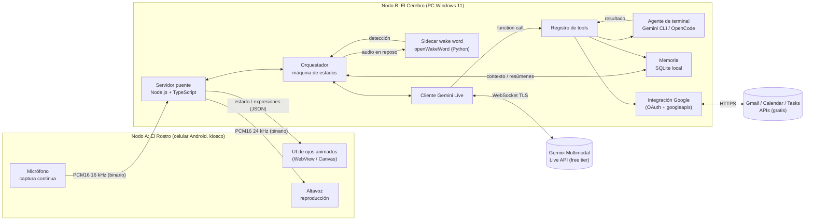
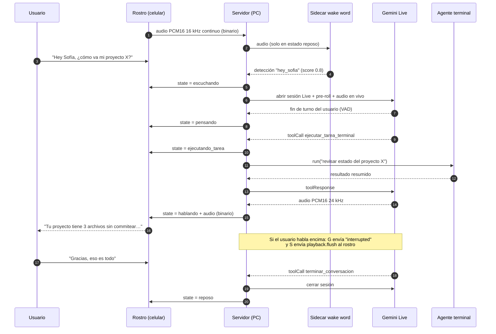
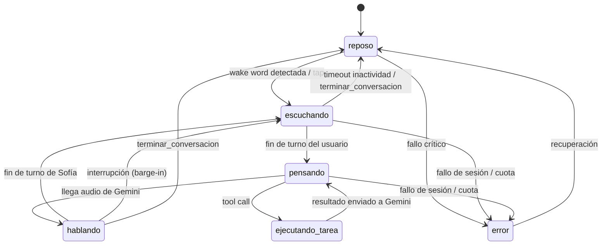
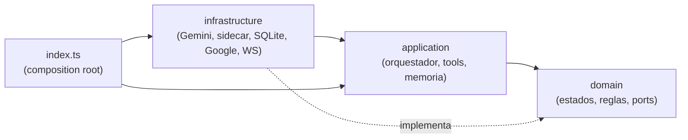

# sophIA: contexto del proyecto

> **Documento fuente de verdad.** Aquí está todo lo que hay que saber sobre el proyecto: visión, arquitectura, protocolo, decisiones y riesgos. El roadmap de desarrollo está en [`plan-backend.md`](./plan-backend.md).
>
> - **Nombre del asistente:** Sofía
> - **Palabra de activación:** "Hey Sofía"
> - **Desarrollador:** Juan David Mendivelso Zuleta (único desarrollador)
> - **Repositorio:** `github.com/JuanMendivelsoZuleta/sophIA-`
> - **Última actualización:** 2026-11-13

---

## Índice

1. [Visión](#1-visión)
2. [Principios y restricciones](#2-principios-y-restricciones)
3. [Glosario](#3-glosario)
4. [Arquitectura general](#4-arquitectura-general)
5. [Flujo de una interacción](#5-flujo-de-una-interacción)
6. [Máquina de estados](#6-máquina-de-estados)
7. [Stack tecnológico](#7-stack-tecnológico)
8. [Pipeline de audio](#8-pipeline-de-audio)
9. [Protocolo WebSocket v1](#9-protocolo-websocket-v1)
10. [Estructura de carpetas](#10-estructura-de-carpetas)
11. [Capa de voz: Gemini Live](#11-capa-de-voz-gemini-live)
12. [Wake word "Hey Sofía"](#12-wake-word-hey-sofía)
13. [Capa de acción: agente de terminal](#13-capa-de-acción-agente-de-terminal)
14. [Memoria persistente](#14-memoria-persistente)
15. [Integración con Google](#15-integración-con-google)
16. [Nodo físico: detalles del celular](#16-nodo-físico-detalles-del-celular)
17. [Fases de desarrollo](#17-fases-de-desarrollo)
18. [Objetivo actual](#18-objetivo-actual)
19. [Riesgos y limitaciones](#19-riesgos-y-limitaciones)
20. [Decisiones (ADR resumido)](#20-decisiones-adr-resumido)
21. [Presupuesto de latencia y métricas](#21-presupuesto-de-latencia-y-métricas)
22. [Referencias](#22-referencias)
23. [Apéndice: brief original](#23-apéndice-brief-original)

---

## 1. Visión

Construir un **asistente virtual con presencia física**, al estilo de Alexa o de un robot de escritorio mejorado, con **costo de software $0**.

- Un **celular Android viejo** funciona como **terminal física dedicada** ("el rostro"): muestra ojos animados, escucha y habla.
- El **computador personal** funciona como **cerebro central** ("el cerebro"): detecta la palabra de activación, conversa por voz con Gemini Live y ejecuta tareas reales en la terminal del PC mediante un agente CLI.

El resultado esperado: decir _"Hey Sofía"_ en el escritorio, tener una conversación natural por voz (con interrupciones) y pedirle tareas técnicas ("revisa el estado de git de mi proyecto", "corre los tests") que se ejecutan en el PC, mientras los ojos del robot reflejan en todo momento qué está haciendo.

Además, Sofía **recuerda** quién es el usuario, a qué se dedica y de qué hablaron antes (memoria local en el PC), y puede **leer correos y gestionar la agenda y tareas de Google** por voz, siempre con herramientas gratuitas.

---

## 2. Principios y restricciones

| Principio                         | Qué significa en la práctica                                                                                                                                                              |
| --------------------------------- | ----------------------------------------------------------------------------------------------------------------------------------------------------------------------------------------- |
| **Software a $0**                 | Solo capas gratuitas (_free tier_) y software open source. Sin suscripciones ni servicios de pago. Si una función exige facturación, se descarta.                                         |
| **Datos personales locales**      | La memoria y los tokens de Google viven en `data/` en el PC, fuera de git. Nada de eso se envía al celular.                                                                               |
| **Desacoplamiento estricto**      | Dos nodos independientes (cliente y servidor) que solo se comunican por un protocolo WebSocket versionado. Se puede reemplazar cualquiera de los dos sin tocar el otro.                   |
| **Local-first**                   | La detección de la palabra de activación ocurre 100% en el PC. **No se envía audio continuo a la nube**: solo se abre la sesión con Gemini después de oír "Hey Sofía".                    |
| **Thin client**                   | El celular no ejecuta lógica de IA ni decide nada: muestra, captura y reproduce. Toda la lógica vive en el servidor.                                                                      |
| **El servidor manda**             | El servidor es la única fuente de verdad del estado del sistema; el cliente solo lo representa.                                                                                           |
| **Un solo desarrollador**         | Se prefieren soluciones simples, con pocas piezas móviles y bien probadas. Cada hito debe producir algo demostrable.                                                                      |
| **Seguridad por defecto**         | Ninguna acción destructiva en el PC se ejecuta sin confirmación explícita, y todo queda auditado.                                                                                         |
| **Entorno**                       | PC con **Windows 11**. Celular con **Android 9 o superior**.                                                                                                                              |
| **Arquitectura limpia**           | Servidor en capas `domain` ← `application` ← `infrastructure`, con dependencias solo hacia dentro e interfaces (_ports_) para todo lo externo ([sección 10](#10-estructura-de-carpetas)). |
| **Git ordenado**                  | Trabajo en ramas, integración por Pull Request y commits convencionales y atómicos ([sección 2.1](#21-flujo-de-trabajo-con-git)).                                                         |
| **Reutilizar antes de construir** | Sobre todo en el frontend (ojos y animaciones): buscar primero librerías y repositorios open source gratuitos y adaptarlos, en lugar de empezar de cero.                                  |

### 2.1 Flujo de trabajo con Git

- **Ramas permanentes:**
  - **`main`**: siempre estable; solo recibe merges desde `laboratory`. Nunca se hace commit directo.
  - **`laboratory`**: rama de integración y pruebas. Recibe las ramas de trabajo y ahí se valida todo (CI + pruebas manuales) antes de pasar a `main`. Tampoco recibe commits directos.
- **Ramas de trabajo (corta duración), una por fase o etapa**, creadas desde `laboratory`:

| Prefijo                | Uso                                            | Ejemplo              |
| ---------------------- | ---------------------------------------------- | -------------------- |
| `feat/<fase>-<nombre>` | Una fase del plan (sus hitos van como commits) | `feat/1-mvp-voz`     |
| `fix/<tema>`           | Corrección de errores                          | `fix/reconexion-ws`  |
| `docs/<tema>`          | Solo documentación                             | `docs/memoria`       |
| `refactor/<tema>`      | Reestructuración sin cambiar comportamiento    | `refactor/ports-voz` |
| `chore/<tema>`         | Tooling, dependencias, CI                      | `chore/commitlint`   |

- **Ciclo de una rama:**
  1. Crear la rama desde `laboratory` actualizado.
  2. Commits frecuentes y atómicos, subiendo la rama a GitHub (`git push`) a medida que se avanza; la CI corre en cada push.
  3. Al cerrar la fase (o un bloque grande de hitos): **PR rama → `laboratory`**. Se integra con _merge commit_ (se conservan los commits atómicos) cuando la CI pasa.
  4. Se prueba en `laboratory` (tests + demo del criterio de "hecho").
  5. **PR `laboratory` → `main`** con _merge commit_ cuando todo está validado.
  6. Se **elimina la rama de trabajo** (local y remota).
- Si una fase es larga, se puede hacer PR a `laboratory` por bloques de hitos sin esperar al final, siempre desde la misma rama.
- **Commits inteligentes** con [Conventional Commits](https://www.conventionalcommits.org/): `tipo(ámbito): descripción` en imperativo (`feat(voice): agregar barge-in`). Cada commit es **atómico** (un cambio lógico que compila y pasa los tests) y explica el _por qué_ cuando no es obvio.
- **Automatización (gratis):** commitlint + lefthook (hooks `commit-msg` y `pre-commit`), plantilla de PR y protección de `main` y `laboratory` en GitHub si el repo es público (en repos privados del plan gratuito no está disponible).

---

## 3. Glosario

| Término                      | Definición                                                                                                                                                                                              |
| ---------------------------- | ------------------------------------------------------------------------------------------------------------------------------------------------------------------------------------------------------- |
| **Wake word**                | Palabra o frase de activación ("Hey Sofía") que despierta al asistente.                                                                                                                                 |
| **Thin client**              | Cliente "tonto" que no procesa lógica: solo entrada/salida (pantalla, micrófono, altavoz).                                                                                                              |
| **Lock Task Mode**           | Modo de Android que fija una app en pantalla e impide salir de ella (sin barra de estado, sin botones de navegación, sin notificaciones).                                                               |
| **Device Owner**             | Rol de administración de Android que permite a una app activar Lock Task Mode sin intervención del usuario y controlar políticas del dispositivo.                                                       |
| **`adb reverse`**            | Comando de Android Debug Bridge que expone un puerto del PC dentro del celular a través del cable USB (`adb reverse tcp:8080 tcp:8080`), de modo que el celular accede al servidor en `localhost:8080`. |
| **PCM16**                    | Audio sin comprimir, muestras de 16 bits con signo, little-endian. Es el formato que usan openWakeWord y Gemini Live.                                                                                   |
| **Barge-in**                 | Interrumpir al asistente mientras habla; debe callarse de inmediato y escuchar.                                                                                                                         |
| **AEC**                      | _Acoustic Echo Cancellation_: cancelación de eco para que el micrófono no capte la propia voz del asistente saliendo por el altavoz.                                                                    |
| **VAD**                      | _Voice Activity Detection_: detección de cuándo alguien está hablando y cuándo terminó.                                                                                                                 |
| **Function calling / Tools** | Mecanismo por el cual el modelo de IA pide al servidor ejecutar una función declarada (por ejemplo `ejecutar_tarea_terminal`) y recibe su resultado.                                                    |
| **Sidecar**                  | Proceso auxiliar que corre junto al servidor principal y se comunica con él (aquí: el detector de wake word en Python).                                                                                 |
| **Sesión Live**              | Conexión bidireccional en tiempo real con Gemini Multimodal Live API para una conversación.                                                                                                             |

---

## 4. Arquitectura general

El sistema es una **arquitectura cliente-servidor local** estrictamente desacoplada en dos nodos conectados por **túnel USB mediante `adb reverse`**. La conexión por Wi-Fi (robot portátil) queda como mejora futura en el backlog.



### A. Nodo físico / cliente: "El Rostro" (celular Android dedicado)

- **Rol:** terminal tonta (_thin client_). **No ejecuta lógica de IA** ni conserva funciones de teléfono convencional.
- **Modo kiosco:** corre en **pantalla completa bloqueada** (_Lock Task Mode / Device Owner_), arrancando directamente en la interfaz del robot, **sin barras de sistema ni notificaciones**.
- **Interfaz visual:** muestra **únicamente ojos animados y expresiones dinámicas** (estilo Wall-E / Vector) que reaccionan en tiempo real al estado del sistema: `reposo`, `escuchando`, `pensando`, `hablando`, `ejecutando_tarea`.
- **Audio:** **captura continuamente** el audio del micrófono y lo envía por **WebSocket** al servidor en el PC; **recibe el stream de audio de respuesta** y lo reproduce por su altavoz.

### B. Nodo central / servidor: "El Cerebro" (computador personal)

- **Activación local (_wake word_):** procesamiento **100% local en el PC** (con `openWakeWord`), que analiza el audio entrante del celular para detectar la palabra de activación **sin consumir tokens ni enviar audio continuo a la nube**.
- **Capa de voz (oídos y boca):** una vez activado, abre una **sesión bidireccional en tiempo real** con **Gemini Multimodal Live API** (capa gratuita / _Free Tier_) para manejar la conversación por voz con **baja latencia** e **interrupciones naturales**.
- **Capa de acción (manos en la terminal):** Gemini Live actúa **únicamente como interfaz conversacional** y **delega las tareas técnicas o del sistema operativo** mediante **Function Calling / Tools** a un **agente gratuito conectado a la terminal** (Gemini CLI, OpenCode u Open Interpreter) para **ejecutar comandos, revisar proyectos y automatizar flujos** en el PC.

### Componentes internos del servidor

| Componente             | Capa y carpeta                                                                                           | Responsabilidad                                                                                                            |
| ---------------------- | -------------------------------------------------------------------------------------------------------- | -------------------------------------------------------------------------------------------------------------------------- |
| **Transporte**         | `infrastructure/transport/`                                                                              | Servidor HTTP (sirve la UI de ojos) + servidor WebSocket `/ws`. Valida mensajes y separa frames de texto y binarios.       |
| **Máquina de estados** | `domain/session/`                                                                                        | Estados y transiciones puras, sin I/O.                                                                                     |
| **Orquestador**        | `application/orchestrator/`                                                                              | Decide hacia dónde va el audio (wake word o Gemini), emite `state` al cliente y controla el ciclo de vida de las sesiones. |
| **Audio**              | `shared/audio/`                                                                                          | Ring buffer, pre-roll, conversión y utilidades PCM/WAV.                                                                    |
| **Wake word**          | port en `domain/ports/`, adaptador en `infrastructure/wakeword/`                                         | Interfaz `WakeWordDetector` + cliente del sidecar Python.                                                                  |
| **Voz**                | port `VoiceSession`, adaptador en `infrastructure/voice/`                                                | Cliente de Gemini Live: abrir/cerrar sesión, enviar y recibir audio, transcripciones, interrupciones, reanudación.         |
| **Tools**              | `application/tools/`                                                                                     | Registro, declaraciones de funciones para Gemini y sus manejadores.                                                        |
| **Agentes**            | port `TerminalAgent`, adaptadores en `infrastructure/agents/`                                            | Gemini CLI, OpenCode.                                                                                                      |
| **Seguridad**          | reglas en `domain/security/`, audit log en `infrastructure/audit/`                                       | Allowlist, clasificación de riesgo, confirmaciones y registro de auditoría.                                                |
| **Memoria**            | entidades en `domain/memory/`, casos de uso en `application/memory/`, SQLite en `infrastructure/memory/` | Almacén local, contexto al abrir sesión, resumen y hechos al cerrarla.                                                     |
| **Google**             | port `GoogleClient`, adaptador en `infrastructure/google/`                                               | Cliente OAuth y llamadas a Gmail, Calendar y Tasks.                                                                        |

---

## 5. Flujo de una interacción



**Fin de la conversación:** la sesión Live se cierra cuando (a) Gemini llama a la tool `terminar_conversacion` porque el usuario se despidió, o (b) pasa un **timeout de inactividad** (≈10 s sin voz del usuario después de que Sofía terminó de hablar). En ambos casos el sistema vuelve a `reposo` y el audio vuelve a ir solo al detector local.

**Memoria:** al abrir la sesión, el servidor añade al `systemInstruction` el perfil del usuario y los resúmenes recientes; al cerrarla, guarda la transcripción y genera en segundo plano un resumen y los hechos nuevos ([sección 14](#14-memoria-persistente)).

---

## 6. Máquina de estados

El **servidor es la fuente de verdad**. El cliente solo dibuja el estado que recibe en el mensaje `state`.



| Estado             | Dónde vive       | Significado                                                    | Comportamiento de los ojos                                         |
| ------------------ | ---------------- | -------------------------------------------------------------- | ------------------------------------------------------------------ |
| `reposo`           | Servidor         | Esperando la palabra de activación. Audio → detector local.    | Parpadeo lento, mirada que deriva, brillo atenuado.                |
| `escuchando`       | Servidor         | Sesión Live abierta, el usuario está hablando. Audio → Gemini. | Ojos bien abiertos, leve pulso, atentos.                           |
| `pensando`         | Servidor         | El usuario terminó; esperando respuesta del modelo.            | Miran hacia arriba o de lado, puntos de carga.                     |
| `hablando`         | Servidor         | Sofía reproduce su respuesta.                                  | Ojos que rebotan sutilmente según la amplitud del audio.           |
| `ejecutando_tarea` | Servidor         | Una tool o el agente de terminal está trabajando.              | Ojos entrecerrados y concentrados, motivo de engranaje o progreso. |
| `error`            | Servidor         | Fallo de sesión, cuota agotada, sidecar caído.                 | Ojos en "X" o confundidos; vuelve a reposo al recuperarse.         |
| `desconectado`     | **Solo cliente** | El celular perdió el WebSocket con el PC.                      | Ojos dormidos ("zzz") mientras reintenta conectar.                 |

Además existen **expresiones** puntuales (`feliz`, `confundido`, `sorprendido`, `guiño`…) que se superponen al estado durante unos milisegundos, enviadas con el mensaje `expression`.

---

## 7. Stack tecnológico

| Capa                        | Tecnología                                                                          | Por qué                                                                                                              |
| --------------------------- | ----------------------------------------------------------------------------------- | -------------------------------------------------------------------------------------------------------------------- |
| Runtime del servidor        | **Node.js 22+ + TypeScript 6 (strict)**                                             | Requisito del proyecto; excelente manejo de WebSockets y streams. TypeScript 7 cuando dependency-cruiser lo soporte. |
| Gestor de paquetes          | **pnpm workspaces** (monorepo)                                                      | Comparte el paquete de protocolo entre servidor y UI sin publicar nada.                                              |
| WebSocket                   | **`ws`**                                                                            | Estándar de facto en Node, soporta frames binarios sin overhead.                                                     |
| Gemini Live                 | **`@google/genai`** (`ai.live.connect`)                                             | SDK oficial de Google con soporte para Live API.                                                                     |
| Validación                  | **`zod`**                                                                           | Esquemas compartidos para mensajes WS y variables de entorno.                                                        |
| Logs                        | **`pino`**                                                                          | Logs JSON rápidos; útiles para medir latencias.                                                                      |
| Tests                       | **Vitest**                                                                          | Rápido, nativo de TypeScript.                                                                                        |
| Lint y formato              | **Biome**                                                                           | Una sola herramienta, sin configuración pesada.                                                                      |
| Ejecución en dev            | **`tsx`** (watch)                                                                   | Ejecuta TypeScript sin build en desarrollo.                                                                          |
| UI de ojos                  | **Vite + TypeScript + Canvas 2D**, o una librería open source si encaja (ver abajo) | Ligera, sin framework, 60 fps incluso en GPU vieja.                                                                  |
| Calidad del repo            | **commitlint + lefthook + dependency-cruiser**                                      | Commits convencionales y regla de capas automáticas, gratis.                                                         |
| Wake word                   | **openWakeWord (Python) con ONNX Runtime**                                          | Gratuito, local, permite modelos custom. En Windows se usa ONNX porque `tflite-runtime` no está disponible.          |
| App del celular (Fase 2)    | **Kotlin mínimo + WebView**                                                         | Necesario para Device Owner, Lock Task y arranque al encender.                                                       |
| Agente de terminal (Fase 3) | **Gemini CLI** (primero), **OpenCode** (alternativa), Open Interpreter (opcional)   | Gratuitos y con modo no interactivo invocable desde un proceso hijo.                                                 |

### 7.1 Ojos y animaciones: reutilizar trabajo existente

Antes de programar los ojos (hito 1.2) se dedican **como máximo 2 sesiones** a buscar y probar librerías o repositorios que ya resuelvan parte del trabajo. Candidatos iniciales (**verificar licencia, estado y costo al investigar**):

| Candidato                                                                           | Qué aporta                                                                                   | Cómo usarlo                                                                                                    |
| ----------------------------------------------------------------------------------- | -------------------------------------------------------------------------------------------- | -------------------------------------------------------------------------------------------------------------- |
| **RoboEyes** (FluxGarage, Arduino)                                                  | Ojos de robot con estados de ánimo, parpadeo, mirada y animaciones ya diseñadas.             | Portar la lógica y las ideas a Canvas/TypeScript.                                                              |
| **Cara procedural de Anki Vector / Cozmo** (código liberado por Digital Dream Labs) | Referencia del estilo de ojos buscado: parámetros por ojo e interpolación entre expresiones. | Inspiración para el modelo de "pose" y las transiciones.                                                       |
| **Rive** (`@rive-app/canvas`, runtime open source)                                  | Animaciones con máquina de estados que se controlan desde código.                            | Diseñar los ojos en el editor (verificar que el plan gratuito alcance) y cambiar estados desde `EyesRenderer`. |
| **Lottie** (`lottie-web`) + LottieFiles                                             | Animaciones vectoriales ya hechas, muchas gratuitas.                                         | Expresiones puntuales (feliz, sorprendido); revisar la licencia de cada asset.                                 |
| **GSAP**                                                                            | Librería de tweening, gratuita incluso para uso comercial.                                   | Interpolación suave entre poses si se hace Canvas propio.                                                      |
| Ejemplos de **CodePen** / GitHub ("robot eyes", "animated eyes canvas")             | Fragmentos de ojos animados en Canvas/SVG.                                                   | Ideas y código pequeño, respetando la licencia.                                                                |

**Reglas:** solo licencias gratuitas y compatibles (MIT, Apache 2.0, BSD o similares); rendimiento estable a 60 fps en el celular viejo; todo detrás de la interfaz `EyesRenderer` para poder cambiar de opción; atribuciones en `apps/face/THIRD_PARTY.md`. La elección final se registra en la decisión D17.

---

## 8. Pipeline de audio

| Dirección                | Formato                    | Detalle                                                                                                                                                              |
| ------------------------ | -------------------------- | -------------------------------------------------------------------------------------------------------------------------------------------------------------------- |
| **Micrófono → servidor** | PCM16 LE, mono, **16 kHz** | Chunks de **80 ms = 1280 muestras = 2560 bytes**. Coincide con el frame que espera openWakeWord y con el formato de entrada de Gemini Live (`audio/pcm;rate=16000`). |
| **Servidor → altavoz**   | PCM16 LE, mono, **24 kHz** | Formato nativo de salida de Gemini Live. El cliente lo encola y lo reproduce con Web Audio.                                                                          |

**Captura en el cliente**

- `getUserMedia({ audio: { echoCancellation: true, noiseSuppression: true, autoGainControl: true, channelCount: 1 } })`.
- Un **AudioWorklet** remuestrea de la frecuencia nativa (normalmente 48 kHz) a 16 kHz, convierte a Int16 y agrupa en chunks de 80 ms.
- Cada chunk se envía como **un frame binario** de WebSocket.

**Procesamiento en el servidor**

- Un **ring buffer de pre-roll (~1 s)** guarda siempre el audio reciente. Al detectar "Hey Sofía", ese audio se envía a Gemini para no cortar el inicio de la frase ("Hey Sofía, ¿qué hora es?").
- En `reposo` el audio va **solo** al detector local. En una conversación activa va **solo** a Gemini.
- Mientras Sofía habla, el audio del micrófono se sigue enviando a Gemini (para permitir el barge-in), contando con la cancelación de eco del celular. Si el eco provoca auto-interrupciones, se aplica _gating_ (ver [riesgos](#19-riesgos-y-limitaciones)).

**Reproducción en el cliente**

- Cola de buffers PCM 24 kHz → `AudioBufferSourceNode` programados en secuencia.
- `playback.flush` vacía la cola y detiene el audio en curso **inmediatamente** (barge-in).
- El cliente calcula el RMS del audio que reproduce para animar los ojos en `hablando`.

---

## 9. Protocolo WebSocket v1

### 9.1 Transporte

- **Endpoint único:** `ws://<host>:8080/ws` (con `adb reverse`, `<host>` = `localhost`).
- **Frames de texto = mensajes de control JSON.**
- **Frames binarios = audio crudo PCM16.** La dirección define el significado:
  - cliente → servidor: micrófono, 16 kHz mono;
  - servidor → cliente: voz de Sofía, 24 kHz mono.
- Los formatos exactos se confirman en el intercambio `hello` / `welcome`.
- Los esquemas viven en `packages/protocol` (tipos TypeScript + `zod`), compartidos por servidor y cliente. **Cualquier mensaje inválido se registra y se descarta**, nunca tumba la conexión.

### 9.2 Sobre (envelope) JSON

```jsonc
{
  "v": 1, // versión del protocolo
  "type": "state", // tipo de mensaje
  "id": "m_01HF...", // opcional: id para correlación
  "ts": 1763050000000, // epoch en ms del emisor
  "payload": {} // contenido específico del tipo
}
```

### 9.3 Mensajes cliente → servidor

| `type`              | `payload`                                                                                              | Cuándo                                                                                  |
| ------------------- | ------------------------------------------------------------------------------------------------------ | --------------------------------------------------------------------------------------- |
| `hello`             | `{ deviceId, clientVersion, capabilities: { aec: boolean, sampleRates: number[] }, screen: { w, h } }` | Primer mensaje al conectar.                                                             |
| `mic.start`         | `{}`                                                                                                   | El cliente empezó a enviar audio.                                                       |
| `mic.stop`          | `{ reason? }`                                                                                          | El cliente dejó de enviar audio (permiso revocado, error).                              |
| `playback.started`  | `{ streamId }`                                                                                         | Empezó a sonar una respuesta.                                                           |
| `playback.finished` | `{ streamId }`                                                                                         | Terminó de sonar (la cola se vació). Ayuda a cerrar el estado `hablando` con precisión. |
| `touch`             | `{ gesture: "tap" \| "long_press" \| "double_tap" }`                                                   | Toque en pantalla: tap = despertar sin wake word (respaldo), long press = push-to-talk. |
| `pong`              | `{ nonce }`                                                                                            | Respuesta a `ping`.                                                                     |
| `log`               | `{ level: "debug" \| "info" \| "warn" \| "error", msg, data? }`                                        | Depuración remota del celular (que no tiene consola visible).                           |

### 9.4 Mensajes servidor → cliente

| `type`           | `payload`                                                                                                                                                                        | Cuándo                                                                      |
| ---------------- | -------------------------------------------------------------------------------------------------------------------------------------------------------------------------------- | --------------------------------------------------------------------------- |
| `welcome`        | `{ sessionId, serverVersion, audioIn: { format: "pcm_s16le", sampleRate: 16000, channels: 1, frameMs: 80 }, audioOut: { format: "pcm_s16le", sampleRate: 24000, channels: 1 } }` | Respuesta a `hello`.                                                        |
| `state`          | `{ state: "reposo" \| "escuchando" \| "pensando" \| "hablando" \| "ejecutando_tarea" \| "error", detail? }`                                                                      | Cada vez que cambia el estado. También se envía justo después de `welcome`. |
| `expression`     | `{ name: "feliz" \| "confundido" \| "sorprendido" \| "guiño" \| ..., durationMs }`                                                                                               | Expresión puntual superpuesta al estado.                                    |
| `playback.start` | `{ streamId }`                                                                                                                                                                   | Anuncia que vienen frames binarios de una nueva respuesta.                  |
| `playback.flush` | `{ streamId? }`                                                                                                                                                                  | **Barge-in:** cortar el audio ya mismo y vaciar la cola.                    |
| `playback.end`   | `{ streamId }`                                                                                                                                                                   | No vendrán más frames de esa respuesta.                                     |
| `transcript`     | `{ role: "user" \| "assistant", text, final: boolean }`                                                                                                                          | Subtítulos o depuración (opcional en la UI).                                |
| `config`         | `{ volume?: 0..1, eyeTheme?: string, showTranscripts?: boolean }`                                                                                                                | Ajustes remotos del rostro.                                                 |
| `ping`           | `{ nonce }`                                                                                                                                                                      | Heartbeat.                                                                  |
| `error`          | `{ code, message, recoverable: boolean }`                                                                                                                                        | Error informativo para el cliente.                                          |

### 9.5 Ejemplos

```json
{
  "v": 1,
  "type": "hello",
  "ts": 1763050000000,
  "payload": {
    "deviceId": "rostro-01",
    "clientVersion": "0.1.0",
    "capabilities": { "aec": true, "sampleRates": [48000] },
    "screen": { "w": 1080, "h": 1920 }
  }
}
```

```json
{
  "v": 1,
  "type": "welcome",
  "ts": 1763050000012,
  "payload": {
    "sessionId": "s_7f3a",
    "serverVersion": "0.1.0",
    "audioIn": { "format": "pcm_s16le", "sampleRate": 16000, "channels": 1, "frameMs": 80 },
    "audioOut": { "format": "pcm_s16le", "sampleRate": 24000, "channels": 1 }
  }
}
```

```json
{
  "v": 1,
  "type": "state",
  "ts": 1763050004200,
  "payload": { "state": "ejecutando_tarea", "detail": "Revisando git en proyecto X" }
}
```

```json
{ "v": 1, "type": "playback.flush", "ts": 1763050007000, "payload": { "streamId": "r_12" } }
```

### 9.6 Conexión, heartbeat y reconexión

1. El cliente abre el WebSocket y envía `hello`.
2. El servidor responde `welcome` y luego el `state` actual.
3. El cliente envía `mic.start` y empieza a mandar frames binarios.
4. El servidor envía `ping` cada **5 s**; si no recibe `pong` en **15 s**, cierra la conexión.
5. Si se cae la conexión, el cliente muestra `desconectado` y reintenta con **backoff exponencial** (1 s, 2 s, 4 s… máximo 30 s).
6. **Un solo rostro activo:** si se conecta un segundo cliente, el servidor cierra el anterior (código `4001`, "reemplazado").
7. **Códigos de cierre propios** (constante `CLOSE_CODES` en `packages/protocol`): `4001` reemplazado, `4002` versión no soportada, `4003` sin `pong` dentro del plazo del heartbeat.

### 9.7 Versionado

- El campo `v` identifica la versión del protocolo. Los cambios compatibles (campos nuevos opcionales) no suben la versión; los incompatibles suben a `v: 2`.
- Si el servidor recibe un `hello` con una versión que no soporta, responde `error` (`code: "unsupported_version"`) y cierra con el código `4002`. Un mensaje que no es `hello` con otra versión solo se registra y se descarta.

---

## 10. Estructura de carpetas

Monorepo con pnpm workspaces:

```
sophIA-/
├── docs/
│   ├── context.md              ← este documento
│   ├── plan-backend.md         ← roadmap
│   └── adr/                    ← decisiones de arquitectura detalladas (cuando hagan falta)
├── packages/
│   └── protocol/               ← tipos + esquemas zod de los mensajes WS (compartido)
│       └── src/
│           ├── envelope.ts
│           ├── client-messages.ts
│           ├── server-messages.ts
│           └── index.ts
├── apps/
│   ├── server/                 ← el cerebro (Node.js + TypeScript), arquitectura limpia
│   │   ├── src/
│   │   │   ├── index.ts        ← composition root: crea los adaptadores e inyecta dependencias
│   │   │   ├── config/         ← env.ts (validación zod), constantes
│   │   │   ├── domain/         ← núcleo puro: sin I/O ni librerías externas
│   │   │   │   ├── session/    ← estados, transiciones, eventos
│   │   │   │   ├── security/   ← clasificación de riesgo, reglas de allowlist
│   │   │   │   ├── memory/     ← entidades: perfil, hecho, sesión
│   │   │   │   └── ports/      ← interfaces: VoiceSession, WakeWordDetector, TerminalAgent, MemoryStore, GoogleClient…
│   │   │   ├── application/    ← casos de uso; solo dependen de domain
│   │   │   │   ├── orchestrator/ ← orquestador de la sesión
│   │   │   │   ├── tools/      ← registro y handlers de tools
│   │   │   │   └── memory/     ← context-builder, resumidor
│   │   │   ├── infrastructure/ ← adaptadores que implementan los ports
│   │   │   │   ├── transport/  ← ws-server.ts, http estático (sirve apps/face)
│   │   │   │   ├── voice/      ← cliente Gemini Live
│   │   │   │   ├── wakeword/   ← cliente del sidecar openWakeWord
│   │   │   │   ├── agents/     ← Gemini CLI, OpenCode
│   │   │   │   ├── memory/     ← store SQLite
│   │   │   │   ├── google/     ← OAuth + googleapis
│   │   │   │   └── audit/      ← audit log (logs/actions.jsonl)
│   │   │   └── shared/         ← utilidades puras: audio (ring buffer, PCM/WAV), logger, Result
│   │   └── test/               ← espeja src/: unitarias (domain, application) e integración (infrastructure)
│   ├── face/                   ← UI web de ojos (Vite + TS)
│   │   ├── THIRD_PARTY.md      ← atribuciones de librerías o assets reutilizados
│   │   └── src/
│   │       ├── main.ts         ← composition root del cliente
│   │       ├── net/            ← cliente WS + reconexión
│   │       ├── audio/          ← AudioWorklet de captura, reproductor PCM
│   │       └── eyes/           ← interfaz EyesRenderer + implementación (Canvas propio o librería)
│   └── android/                ← Fase 2: app Kotlin de kiosco (WebView)
├── services/
│   └── wakeword/               ← sidecar Python openWakeWord (stdin PCM → stdout JSON)
├── models/                     ← modelos de wake word (.onnx), ignorados por git
├── scripts/                    ← adb-reverse.ps1, dev.ps1, google-auth.ts
├── logs/                       ← logs y audit log, ignorados por git
├── data/                       ← memory.db, credenciales y token de Google, ignorados por git
├── .github/                    ← workflows de CI y plantilla de PR
├── .env.example
├── biome.json                  ← lint y formato
├── commitlint.config.js
├── lefthook.yml
├── .dependency-cruiser.cjs     ← reglas de capas
├── tsconfig.base.json
├── vitest.config.ts
├── pnpm-workspace.yaml
└── README.md
```

### 10.1 Reglas de la arquitectura limpia



1. **Las dependencias apuntan hacia dentro:** `domain` no importa nada de las otras capas ni librerías de I/O; `application` solo importa `domain`; `infrastructure` implementa los ports de `domain`.
2. **Todo lo externo pasa por un port** (interfaz en `domain/ports/`): Gemini, sidecar, agentes CLI, SQLite, Google, reloj. Así cada pieza se reemplaza o se simula en tests sin tocar el resto.
3. **`index.ts` es el único lugar que conoce las implementaciones concretas** y las conecta a mano (sin framework de inyección).
4. **`packages/protocol`** es compartido y no depende de ninguna capa.
5. La regla se verifica en CI con **dependency-cruiser**.
6. En el cliente (`apps/face`) se aplica la misma idea de forma ligera: los ojos se usan solo a través de `EyesRenderer`.

---

## 11. Capa de voz: Gemini Live

**Responsabilidad:** ser los oídos y la boca de Sofía. Solo conversa; **no ejecuta nada por sí misma**: delega con tools.

**Configuración de la sesión** (con `@google/genai`, `ai.live.connect`):

- `responseModalities: [AUDIO]`, voz preconstruida e idioma español.
- `systemInstruction` con la personalidad de Sofía: asistente de escritorio en español, respuestas **breves y habladas** (sin markdown ni listas largas), honesta cuando no sabe, y que **usa las tools para cualquier cosa del sistema operativo**. Incluye además el **bloque de memoria** (perfil y resúmenes recientes, [sección 14](#14-memoria-persistente)).
- `tools`: declaraciones de funciones de la [capa de acción](#13-capa-de-acción-agente-de-terminal).
- `inputAudioTranscription` y `outputAudioTranscription` activados (para subtítulos y logs).
- VAD automático del servidor de Gemini (sensibilidad ajustable en `realtimeInputConfig`).
- `contextWindowCompression` y `sessionResumption` para sesiones largas y reconexiones transparentes. **No son memoria de largo plazo:** solo mantienen viva una conversación en curso.
- **Modelo configurable** con la variable `GEMINI_LIVE_MODEL`. Hay que verificar en la documentación oficial cuál es el modelo Live de audio nativo vigente en el free tier al momento de implementar, porque los nombres cambian seguido.

**Eventos que importan al orquestador**

| Evento de Gemini       | Acción del servidor                                                                                         |
| ---------------------- | ----------------------------------------------------------------------------------------------------------- |
| Llega audio del modelo | `state = hablando`, `playback.start` (si es nuevo), reenviar frames binarios.                               |
| `interrupted`          | `playback.flush` al cliente → `state = escuchando`.                                                         |
| `turnComplete`         | `playback.end`; al confirmarse `playback.finished`, `state = escuchando` e iniciar el timer de inactividad. |
| `toolCall`             | `state = ejecutando_tarea`, ejecutar el handler y devolver `toolResponse`.                                  |
| `goAway` / cierre      | Reanudar con el handle de `sessionResumption` o pasar a `error`.                                            |

**Limitaciones del free tier (verificar al implementar)**

- Límites de peticiones y de sesiones concurrentes.
- Duración máxima de sesión de audio (del orden de 15 min sin compresión de contexto).
- **Privacidad:** en el free tier Google puede usar los datos para mejorar sus productos. No decir información sensible a Sofía.
- La API key va en `.env` (`GEMINI_API_KEY`) y **nunca** se envía al celular.

---

## 12. Wake word "Hey Sofía"

- **Motor:** openWakeWord, 100% local, sin costo.
- **Integración:** como openWakeWord es una librería de Python, corre como **sidecar**: el servidor Node lanza `services/wakeword` como **proceso hijo** y se comunica por **stdio**:
  - stdin: frames PCM16 16 kHz de 1280 muestras;
  - stdout: líneas JSON como `{"event":"detected","model":"hey_sofia","score":0.83}` y `{"event":"ready"}`.
- Motor de inferencia: **ONNX Runtime** (en Windows no hay `tflite-runtime`).
- **Solo se alimenta en `reposo`**: durante una conversación no se gasta CPU en detectar.
- **Umbral configurable** (`WAKEWORD_THRESHOLD`, ~0.5 inicial) y **cooldown** (~2 s) para evitar dobles activaciones.
- **Modelo provisional:** `hey_jarvis` (pre-entrenado) mientras se entrena el modelo custom.
- **Modelo definitivo:** `hey_sofia.onnx`, entrenado con el notebook oficial de openWakeWord (datos sintéticos de TTS + aumentación). "Hey Sofía" tiene dos palabras, lo que reduce falsos positivos frente a una sola palabra.
- **Riesgo:** el pipeline de entrenamiento genera muestras sintéticas pensadas para inglés. Mitigaciones: probar pronunciaciones ("hey so-fi-a"), complementar con grabaciones reales propias y validar con una hora de audio ambiente (TV, conversaciones) para medir falsos positivos.
- Interfaz `WakeWordDetector` en el servidor para poder cambiar de motor sin tocar el orquestador.

---

## 13. Capa de acción: agente de terminal

**Idea central:** Gemini Live **no toca el sistema**. Cuando el usuario pide algo técnico, Gemini llama a una tool; el servidor delega en un **agente CLI gratuito** que corre en la terminal del PC, y devuelve un resumen que Sofía puede decir en voz alta.

### 13.1 Tools expuestas a Gemini

| Tool                      | Parámetros                                 | Qué hace                                                                                      |
| ------------------------- | ------------------------------------------ | --------------------------------------------------------------------------------------------- |
| `ejecutar_tarea_terminal` | `instruccion: string`, `proyecto?: string` | Lanza una tarea en el agente de terminal. Si es larga, responde de inmediato con un `taskId`. |
| `consultar_tarea`         | `taskId: string`                           | Devuelve el estado o resultado de una tarea.                                                  |
| `cancelar_tarea`          | `taskId: string`                           | Cancela una tarea en curso.                                                                   |
| `confirmar_accion`        | `taskId: string`, `confirmado: boolean`    | Registra la confirmación verbal del usuario para una acción de riesgo.                        |
| `terminar_conversacion`   | —                                          | Cierra la sesión Live y vuelve a `reposo`.                                                    |
| (utilidades)              | —                                          | Tools inofensivas para validar el ciclo: hora, estado del sistema, etc.                       |

Las tools de memoria están en la [sección 14](#14-memoria-persistente) y las de Google en la [sección 15](#15-integración-con-google).

### 13.2 Agentes

```ts
interface TerminalAgent {
  readonly name: string;
  run(task: AgentTask, signal: AbortSignal): AsyncIterable<AgentEvent>;
}
```

| Adaptador            | Invocación                                                             | Estado                    |
| -------------------- | ---------------------------------------------------------------------- | ------------------------- |
| **Gemini CLI**       | Modo no interactivo (`gemini -p "<instrucción>" --output-format json`) | Primero en implementarse. |
| **OpenCode**         | `opencode run "<instrucción>"`                                         | Alternativa configurable. |
| **Open Interpreter** | CLI de Python                                                          | Opcional, a futuro.       |

Las banderas exactas de cada CLI (modo de aprobación, formato de salida) se verifican al implementar, porque cambian entre versiones.

### 13.3 Seguridad (obligatoria)

- **Allowlist de directorios:** el agente solo trabaja dentro de las carpetas de proyectos configuradas (`AGENT_ALLOWED_DIRS`).
- **Clasificación de riesgo:** lectura (libre) / escritura (aviso) / destructiva o de red (requiere `confirmar_accion` por voz).
- **Timeout** por tarea y cancelación con `AbortSignal`.
- **Salida acotada:** se trunca y resume antes de devolverla a Gemini; nada de leer en voz alta 300 líneas de log.
- **Audit log** append-only en `logs/actions.jsonl`: fecha, instrucción, agente, directorio, comandos, resultado y confirmación.
- **Kill switch:** variable de entorno o tool para desactivar toda la capa de acción.

### 13.4 Tareas largas

Si una tarea tarda más de unos segundos, la tool responde de inmediato ("tarea iniciada, te aviso al terminar") para no bloquear la conversación. Al terminar:

- si hay una sesión abierta, se le informa el resultado a Gemini;
- si el sistema está en `reposo`, el rostro muestra una expresión de aviso y el resultado queda disponible para la próxima conversación.

---

## 14. Memoria persistente

**Objetivo:** que Sofía recuerde **quién es el usuario, a qué se dedica y de qué hablaron**, como el historial de sesiones de Gemini, pero guardado **localmente en el PC** y gratis.

### 14.1 Almacenamiento

- **SQLite** con `better-sqlite3` en `data/memory.db` (ignorado por git), con búsqueda de texto **FTS5**.

| Tabla      | Contenido                                                          |
| ---------- | ------------------------------------------------------------------ |
| `profile`  | Datos clave del usuario: nombre, ocupación, preferencias.          |
| `facts`    | Recuerdos sueltos con fecha, origen (sesión o tool) e importancia. |
| `sessions` | Inicio, fin y resumen de cada conversación.                        |
| `messages` | Transcripción de cada turno (usuario y Sofía).                     |

### 14.2 Ciclo de vida

1. **Al abrir sesión:** `context-builder` arma un bloque con perfil > hechos importantes > resúmenes de las últimas N sesiones > tareas pendientes, con un límite de tamaño, y lo añade al `systemInstruction`.
2. **Durante la sesión:** se guardan las transcripciones (`inputAudioTranscription` / `outputAudioTranscription`).
3. **Al cerrar sesión:** en segundo plano, un **modelo de texto gratuito de Gemini** (`GEMINI_TEXT_MODEL`, verificar el vigente del free tier) genera un resumen breve y una lista de hechos nuevos en JSON, que se deduplican contra los existentes. Si falla la cuota, la sesión queda pendiente y se reintenta.

### 14.3 Tools

| Tool             | Parámetros                           | Qué hace                                                              |
| ---------------- | ------------------------------------ | --------------------------------------------------------------------- |
| `recordar`       | `dato: string`, `categoria?: string` | Guarda un hecho explícito ("recuerda que mi perro se llama Max").     |
| `buscar_memoria` | `consulta: string`                   | Busca en resúmenes y transcripciones ("¿de qué hablamos el martes?"). |
| `olvidar`        | `hecho?: string`, `todo?: boolean`   | Borra un hecho, o toda la memoria con confirmación por voz.           |

### 14.4 Privacidad

- La memoria nunca sale del PC, salvo el bloque de contexto que se envía a Gemini al abrir cada sesión.
- Scripts para exportar la memoria a JSON y borrarla por completo; retención configurable (`MEMORY_RETENTION_DAYS`).
- Kill switch: `MEMORY_ENABLED=false`.

---

## 15. Integración con Google

**Objetivo:** leer correos y gestionar agenda y tareas de Google por voz, **sin costo**.

### 15.1 Costo y autorización

- Proyecto de Google Cloud **sin facturación**; las APIs de Gmail, Calendar, Tasks y Drive son gratuitas dentro de sus cuotas (de sobra para uso personal). Se verifica al implementar; si alguna exige facturación, se descarta.
- Cliente OAuth tipo **Desktop app** con flujo _loopback_ (`scripts/google-auth.ts`), librería `googleapis`.
- Credenciales y token en `data/` (ignorados por git); el token se refresca solo y nunca va al celular.
- En estado _Testing_ de la pantalla de consentimiento los refresh tokens caducan a los 7 días; para uso personal se pasa a _In production_ sin verificar (aviso de "app no verificada", hasta 100 usuarios). Verificar el comportamiento vigente.
- **Scopes mínimos**, empezando por solo lectura: `gmail.readonly`, `calendar.readonly`, `tasks`; `calendar.events` solo cuando se habilite crear eventos.

### 15.2 Tools

| Tool                                          | Parámetros                   | Qué hace                                                |
| --------------------------------------------- | ---------------------------- | ------------------------------------------------------- |
| `resumen_correos`                             | `cantidad?`, `soloNoLeidos?` | Remitente, asunto y fragmento de los correos recientes. |
| `buscar_correos`                              | `consulta: string`           | Búsqueda con la sintaxis de Gmail.                      |
| `leer_correo`                                 | `id: string`                 | Cuerpo en texto plano, truncado y resumido.             |
| `agenda`                                      | `desde?`, `hasta?`           | Eventos del calendario (hoy por defecto).               |
| `crear_evento`                                | `titulo`, `inicio`, `fin?`   | Crea un evento **tras confirmación por voz**.           |
| `listar_tareas_google` / `crear_tarea_google` | — / `titulo`, `fecha?`       | Google Tasks.                                           |

**Enviar correos** queda fuera por ahora (backlog, con confirmación obligatoria).

### 15.3 Seguridad

- El contenido de correos es **dato externo no confiable**: se limpia el HTML, se trunca y se marca como tal ante Gemini.
- **Inyección de instrucciones:** después de leer un correo, cualquier tool de acción (terminal, crear evento…) exige confirmación por voz durante el resto de la sesión.
- Todas las llamadas a Google quedan en `logs/actions.jsonl`. Kill switch: `GOOGLE_ENABLED=false`.
- **Privacidad:** lo que Sofía lee en voz alta pasa por Gemini (free tier), que puede usar los datos para mejorar sus productos.

---

## 16. Nodo físico: detalles del celular

### 16.1 Modo kiosco (Android 9+)

- App Kotlin mínima con una **WebView a pantalla completa** que carga la UI de ojos.
- **Device Owner:** `adb shell dpm set-device-owner <paquete>/.AdminReceiver`. **Requisito:** el celular no debe tener cuentas configuradas (normalmente implica un restablecimiento de fábrica).
- `startLockTask()` con la app en la lista de Lock Task: sin barra de estado, sin navegación, sin notificaciones.
- Registrada como **launcher (HOME)** y con **receptor de `BOOT_COMPLETED`**: al encender, arranca directo en los ojos.
- Pantalla siempre encendida (`FLAG_KEEP_SCREEN_ON`), modo inmersivo y app excluida de la optimización de batería.
- Permiso de micrófono concedido en la app y otorgado a la página con `WebChromeClient.onPermissionRequest`.

### 16.2 Conectividad y contexto seguro

`getUserMedia` (micrófono en la web) **solo funciona en un contexto seguro**: HTTPS o `localhost`.

| Modo                                   | Cómo                                                                     | Ventajas                                                                                               | Desventajas                                                                                                                                  |
| -------------------------------------- | ------------------------------------------------------------------------ | ------------------------------------------------------------------------------------------------------ | -------------------------------------------------------------------------------------------------------------------------------------------- |
| **USB + `adb reverse`** (modo oficial) | `adb reverse tcp:8080 tcp:8080`; el celular abre `http://localhost:8080` | Es `localhost`, así que es contexto seguro sin certificados; latencia mínima; además carga el celular. | Cable USB permanente; requiere que `adb` esté corriendo en el PC.                                                                            |
| **Wi-Fi** (backlog, robot portátil)    | El celular abre `https://<ip-del-pc>:8443`                               | Sin cables de datos.                                                                                   | Requiere TLS local (certificado con mkcert instalado en el celular) o servir la UI desde la app con `WebViewAssetLoader`; latencia variable. |

### 16.3 Audio en el celular

- Altavoz y micrófono están a centímetros: la **cancelación de eco (AEC)** es crítica. Android 9+ con WebView moderno aplica AEC por hardware/software al pedir `echoCancellation: true`.
- Si la AEC del dispositivo no basta, alternativas: _gating_ en el servidor mientras Sofía habla, ajustar la sensibilidad del VAD de Gemini, o captura nativa con `AudioRecord` + `AcousticEchoCanceler`.

### 16.4 Hardware

- **Batería:** un celular enchufado 24/7 puede inflar la batería. Vigilarlo; si el dispositivo lo permite, limitar la carga o usarlo sin batería.
- Soporte físico que oriente la pantalla y deje libres micrófono y altavoz.

---

## 17. Fases de desarrollo

1. **Fase 1 (MVP de voz):** crear el **servidor puente en Node.js/TypeScript** en el PC + **interfaz web con ojos animados** + **conexión bidireccional con Gemini Live API** y **wake word local**. Durante esta fase el "rostro" es el navegador del propio PC.
2. **Fase 2 (despliegue en el celular):** configurar el **celular viejo en modo kiosco** conectado por **USB (`adb reverse`)** al servidor del PC.
3. **Fase 3 (agente de terminal):** integrar **herramientas (tools)** que conecten el servidor puente con un **agente CLI en la terminal** para ejecutar tareas reales bajo demanda por voz.
4. **Fase 4 (memoria persistente):** memoria local en SQLite para recordar al usuario y las conversaciones pasadas.
5. **Fase 5 (Google):** lectura de Gmail y gestión de Calendar y Tasks con OAuth propio y APIs gratuitas.
6. **Fase 6 (backlog):** modo Wi-Fi / robot portátil, envío de correos, fallback local, etc.

Detalle de hitos, tareas y criterios de "hecho": [`plan-backend.md`](./plan-backend.md).

---

## 18. Objetivo actual

1. Diseñar la **arquitectura de carpetas** → [sección 10](#10-estructura-de-carpetas).
2. Definir el **protocolo de mensajes WebSocket** entre el cliente (rostro) y el servidor (PC) → [sección 9](#9-protocolo-websocket-v1).
3. Construir el **MVP de la Fase 1** con **TypeScript/Node.js** y una **interfaz web ligera** para los ojos animados → [`plan-backend.md`, Fase 1](./plan-backend.md).

---

## 19. Riesgos y limitaciones

| Riesgo                                                              | Impacto | Probabilidad    | Mitigación                                                                                                                |
| ------------------------------------------------------------------- | ------- | --------------- | ------------------------------------------------------------------------------------------------------------------------- |
| Cambios o recortes en el free tier de Gemini Live (modelos, cuotas) | Alto    | Media           | Modelo configurable por env; capa `voice/` aislada tras una interfaz; fallback local (whisper.cpp + Piper) en el backlog. |
| Eco: Sofía se interrumpe a sí misma                                 | Alto    | Alta en celular | AEC del dispositivo, _gating_ mientras habla, sensibilidad del VAD, captura nativa si hace falta.                         |
| Falsos positivos o negativos del wake word                          | Medio   | Media           | Umbral y cooldown configurables, modelo de dos palabras, pruebas con audio ambiente, tap como respaldo.                   |
| Entrenamiento de "Hey Sofía" en español con datos sintéticos        | Medio   | Media           | Usar `hey_jarvis` mientras tanto, sumar grabaciones reales, iterar el modelo.                                             |
| Latencia de Wi-Fi                                                   | Bajo    | —               | USB + `adb reverse` como único modo; Wi-Fi movido al backlog.                                                             |
| Memoria que crece o gasta demasiados tokens                         | Medio   | Media           | Límite de tamaño del bloque de contexto, resúmenes en lugar de transcripciones, retención configurable.                   |
| Inyección de instrucciones desde un correo                          | Alto    | Media           | Contenido marcado como no confiable; confirmación por voz de toda acción tras leer un correo.                             |
| Google exige facturación o caduca el token OAuth                    | Medio   | Baja            | Verificar costo antes de implementar; app en _In production_; descartar si exige pago.                                    |
| Datos personales (memoria, correos) expuestos                       | Alto    | Baja            | Todo en `data/` fuera de git, scopes mínimos, kill switches, export y borrado de memoria.                                 |
| Contexto seguro para el micrófono en la WebView                     | Medio   | Alta por Wi-Fi  | `localhost` vía `adb reverse`; TLS local o `WebViewAssetLoader` para Wi-Fi.                                               |
| El agente de terminal ejecuta algo destructivo                      | Alto    | Baja            | Allowlist, clasificación de riesgo, confirmación por voz, audit log, kill switch.                                         |
| Batería del celular inflada por carga continua                      | Medio   | Media           | Vigilar, limitar carga o retirar batería.                                                                                 |
| Sesiones Live que expiran a mitad de conversación                   | Bajo    | Media           | `sessionResumption` y `contextWindowCompression`.                                                                         |
| Alcance demasiado grande para una sola persona                      | Alto    | Media           | Hitos pequeños y demostrables; backlog explícito para lo no esencial.                                                     |

---

## 20. Decisiones (ADR resumido)

| #   | Decisión                                                                                                            | Estado                          | Motivo                                                                               |
| --- | ------------------------------------------------------------------------------------------------------------------- | ------------------------------- | ------------------------------------------------------------------------------------ |
| D1  | Cliente-servidor desacoplado por WebSocket local                                                                    | ✅ Tomada                       | Requisito base; permite cambiar el rostro o el cerebro por separado.                 |
| D2  | Node.js + TypeScript para el servidor                                                                               | ✅ Tomada                       | Requisito del proyecto.                                                              |
| D3  | Monorepo pnpm con paquete `protocol` compartido                                                                     | ✅ Tomada                       | Un solo lugar para los tipos del protocolo.                                          |
| D4  | JSON para control y binario crudo para audio en el mismo socket                                                     | ✅ Tomada                       | Simple y sin overhead de base64 en el audio.                                         |
| D5  | Wake word "Hey Sofía" con openWakeWord en sidecar Python por stdio                                                  | ✅ Tomada                       | openWakeWord es Python; stdio evita puertos extra y es fácil de supervisar.          |
| D6  | Gemini Live como única capa de voz (sin STT/TTS separados)                                                          | ✅ Tomada                       | Baja latencia e interrupciones naturales, gratis.                                    |
| D7  | Servidor como fuente de verdad del estado                                                                           | ✅ Tomada                       | El cliente queda tonto y fácil de reemplazar.                                        |
| D8  | Celular Android 9+ con app Kotlin + WebView para kiosco                                                             | ✅ Tomada                       | Device Owner y Lock Task requieren app nativa; la UI sigue siendo web.               |
| D9  | USB (`adb reverse`) vs Wi-Fi como modo definitivo                                                                   | ✅ Tomada: USB                  | Wi-Fi / robot portátil se mueve al backlog (Fase 6).                                 |
| D10 | Audio en el celular: WebView (`getUserMedia`) vs nativo (`AudioRecord`)                                             | ⏳ Abierta                      | Empezar con WebView; pasar a nativo solo si la AEC falla.                            |
| D11 | Agente de terminal por defecto                                                                                      | ⏳ Abierta (Gemini CLI primero) | Validar en Fase 3.2 frente a OpenCode.                                               |
| D12 | Memoria local en SQLite (`better-sqlite3` + FTS5) inyectada en el `systemInstruction`                               | ✅ Tomada                       | Gratis, local, sin servidor extra; `sessionResumption` no da memoria de largo plazo. |
| D13 | Resumen de sesiones con un modelo de texto gratuito de Gemini                                                       | ✅ Tomada                       | Reutiliza la misma API key; modelo configurable por env.                             |
| D14 | Google vía OAuth propio (Desktop app) + `googleapis`, solo lectura al inicio                                        | ✅ Tomada                       | APIs gratuitas; scopes mínimos reducen el riesgo.                                    |
| D15 | Búsqueda semántica con embeddings en la memoria                                                                     | ⏳ Abierta                      | FTS5 primero; embeddings solo si hay un modelo gratuito y hace falta.                |
| D16 | Arquitectura limpia (domain / application / infrastructure, ports y adaptadores) + ramas, PR y Conventional Commits | ✅ Tomada                       | Orden, piezas reemplazables y tests con mocks; historial legible.                    |
| D17 | Implementación de los ojos: librería/repositorio reutilizado vs Canvas propio                                       | ⏳ Abierta                      | Se decide tras la investigación del hito 1.2 (sección 7.1).                          |

---

## 21. Presupuesto de latencia y métricas

| Métrica                                          | Objetivo                                |
| ------------------------------------------------ | --------------------------------------- |
| "Hey Sofía" → ojos en `escuchando`               | < 300 ms                                |
| Fin de habla del usuario → primer audio de Sofía | < 1.5 s                                 |
| Barge-in → silencio en el altavoz                | < 200 ms                                |
| Reconexión del rostro tras caída del servidor    | < 5 s después de que vuelva el servidor |
| Falsos positivos del wake word                   | < 1 por hora de audio ambiente          |
| Animación de ojos                                | 60 fps estables en el celular           |

El servidor registra estas latencias en los logs (`pino`) para poder medirlas en cada hito.

---

## 22. Referencias

- openWakeWord: <https://github.com/dscripka/openWakeWord>
- Gemini Live API: <https://ai.google.dev/gemini-api/docs/live>
- SDK `@google/genai`: <https://github.com/googleapis/js-genai>
- Gemini CLI: <https://github.com/google-gemini/gemini-cli>
- OpenCode: <https://opencode.ai>
- Open Interpreter: <https://github.com/openinterpreter/open-interpreter>
- Android Lock Task Mode: <https://developer.android.com/work/dpc/dedicated-devices/lock-task-mode>
- Android Device Owner (dispositivos dedicados): <https://developer.android.com/work/dpc/dedicated-devices>
- `adb reverse`: <https://developer.android.com/tools/adb>
- Web Audio `AudioWorklet`: <https://developer.mozilla.org/docs/Web/API/AudioWorklet>
- mkcert (TLS local): <https://github.com/FiloSottile/mkcert>
- `better-sqlite3`: <https://github.com/WiseLibs/better-sqlite3>
- SQLite FTS5: <https://www.sqlite.org/fts5.html>
- Gmail API: <https://developers.google.com/gmail/api>
- Google Calendar API: <https://developers.google.com/calendar/api>
- Google Tasks API: <https://developers.google.com/tasks>
- `googleapis` (Node): <https://github.com/googleapis/google-api-nodejs-client>
- OAuth para apps de escritorio: <https://developers.google.com/identity/protocols/oauth2/native-app>
- Conventional Commits: <https://www.conventionalcommits.org/>
- commitlint: <https://commitlint.js.org/>
- lefthook: <https://github.com/evilmartians/lefthook>
- dependency-cruiser: <https://github.com/sverweij/dependency-cruiser>
- RoboEyes (FluxGarage): <https://github.com/FluxGarage/RoboEyes>
- Código de Anki Vector (Digital Dream Labs): <https://github.com/digital-dream-labs>
- Rive runtime web: <https://github.com/rive-app/rive-wasm>
- lottie-web: <https://github.com/airbnb/lottie-web>
- GSAP: <https://gsap.com/>

---

## 23. Apéndice: brief original

Texto original del proyecto, conservado íntegro como referencia:

> # Contexto y Visión del Proyecto: Asistente Robótico de Escritorio (Voz + Terminal)
>
> Quiero construir un asistente virtual con presencia física (estilo Alexa / robot de escritorio mejorado) con costo de software $0, utilizando un **celular Android viejo como terminal física dedicada** y **mi computador como cerebro central**.
>
> ## 1. Arquitectura General (Cliente-Servidor Local)
>
> El sistema debe estar estrictamente desacoplado en dos nodos conectados por red local (Wi-Fi o túnel USB mediante `adb reverse`):
>
> ### A. Nodo Físico / Cliente ("El Rostro" — Celular Android Dedicado)
>
> - **Rol:** Terminal tonta (_thin client_). No ejecuta lógica de IA ni conserva funciones de teléfono convencional.
> - **Modo Kiosco:** Correrá en pantalla completa bloqueada (_Lock Task Mode / Device Owner_), arrancando directamente en la interfaz del robot sin barras de sistema ni notificaciones.
> - **Interfaz Visual:** Mostrará únicamente ojos animados y expresiones dinámicas (estilo Wall-E / Vector) que reaccionan en tiempo real al estado del sistema (`reposo`, `escuchando`, `pensando`, `hablando`, `ejecutando_tarea`).
> - **Audio:** Captura continuamente el audio del micrófono y lo envía por WebSocket al servidor en el PC; recibe el stream de audio de respuesta y lo reproduce por su altavoz.
>
> ### B. Nodo Central / Servidor ("El Cerebro" — Mi Computador)
>
> - **Activación Local (_Wake Word_):** Procesamiento 100% local en el PC (ej. `openWakeWord`) analizando el audio entrante del celular para detectar la palabra de activación sin consumir tokens ni enviar audio continuo a la nube.
> - **Capa de Voz (Oídos y Boca):** Una vez activado, abre una sesión bidireccional en tiempo real usando **Gemini Multimodal Live API** (capa gratuita / _Free Tier_) para manejar la conversación por voz con baja latencia e interrupciones naturales.
> - **Capa de Acción (Manos en la Terminal):** Gemini Live actuará únicamente como interfaz conversacional y delegará las tareas técnicas o del sistema operativo mediante _Function Calling / Tools_ hacia un **agente gratuito conectado a mi terminal** (ej. Gemini CLI, OpenCode o Open Interpreter) para ejecutar comandos, revisar proyectos y automatizar flujos en mi PC.
>
> ## 2. Fases de Desarrollo
>
> 1. **Fase 1 (MVP de Voz):** Crear el servidor puente en Node.js/TypeScript en el PC + interfaz web con ojos animados + conexión bidireccional con Gemini Live API y _Wake Word_ local.
> 2. **Fase 2 (Despliegue en el Celular):** Configurar el celular viejo en Modo Kiosco conectado por WebSocket local (Wi-Fi / USB) al servidor del PC.
> 3. **Fase 3 (Agente de Terminal):** Integrar herramientas (_Tools_) que conecten el servidor puente con un agente CLI en mi terminal para ejecutar tareas reales bajo demanda por voz.
>
> ## 3. Objetivo Actual
>
> Ayúdame a diseñar la arquitectura de carpetas, el protocolo de mensajes WebSocket entre el cliente (rostro) y el servidor (PC), y empecemos por construir el **MVP de la Fase 1** usando TypeScript/Node.js y una interfaz web ligera para los ojos animados.
