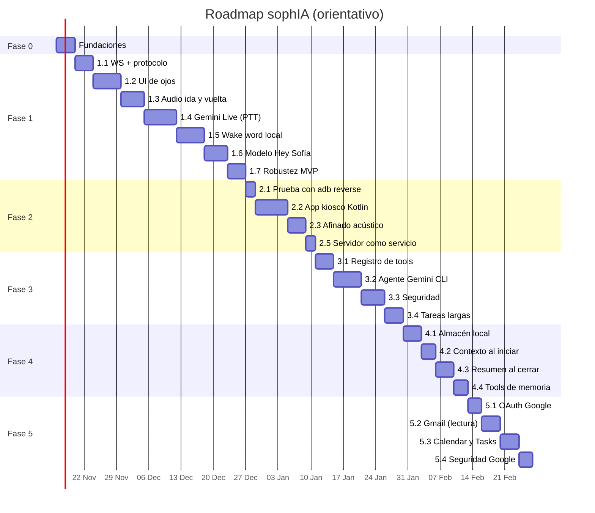

# sophIA: plan de desarrollo (roadmap)

> Roadmap para **un solo desarrollador**. Se centra en el servidor ("el cerebro"), pero cubre todo lo necesario para llegar al robot completo: UI de ojos, celular en kiosco, agente de terminal, memoria persistente e integración con Google.
>
> **Regla de costo:** todo lo que entra en este plan debe ser **gratuito**. Si al implementar algo resulta que exige pago o facturación, se descarta o se mueve al backlog.
>
> Contexto, arquitectura y protocolo: [`context.md`](./context.md). Si este plan y `context.md` no coinciden, **`context.md` manda** y este plan se corrige.

---

## Resumen

| Fase                                   | Objetivo                                                   | Estimación*   | Entregable                                                                                 |
| -------------------------------------- | ---------------------------------------------------------- | ------------- | ------------------------------------------------------------------------------------------ |
| **0. Fundaciones**                     | Repo, tooling y protocolo base                             | ≈ 0.5 semanas | `pnpm dev` levanta el servidor y la CI pasa.                                               |
| **1. MVP de voz**                      | Hablar con Sofía desde el navegador del PC                 | ≈ 4–5 semanas | "Hey Sofía" → conversación por voz → vuelve a reposo sola.                                 |
| **2. Celular**                         | El celular viejo como rostro en kiosco                     | ≈ 2–3 semanas | El celular arranca directo en los ojos y funciona sin tocar el PC.                         |
| **3. Agente de terminal**              | Tareas reales por voz en el PC                             | ≈ 3 semanas   | "Hey Sofía, revisa el git del proyecto X" funciona y queda auditado.                       |
| **4. Memoria persistente**             | Que Sofía recuerde quién eres, qué haces y lo que hablaron | ≈ 2–3 semanas | En una sesión nueva, tras reiniciar el PC, Sofía sabe tu nombre y retoma temas anteriores. |
| **5. Google (Gmail, Calendar, Tasks)** | Leer correos y gestionar agenda por voz                    | ≈ 2–3 semanas | "Hey Sofía, ¿tengo correos nuevos?" y "¿qué tengo hoy?" funcionan de forma segura.         |
| **6. Backlog**                         | Mejoras futuras (incluye modo Wi-Fi portátil)              | —             | —                                                                                          |

\* Estimación orientativa a ritmo _part-time_ (≈ 10–15 h/semana). Sirve para detectar desvíos, no es un compromiso.

---

## Cómo usar este plan

- **Orden estricto de hitos.** Cada hito se apoya en el anterior. Saltarse uno suele costar más tiempo después.
- **Arquitectura limpia** (ver sección 10 de `context.md`): `domain` (núcleo puro) ← `application` (casos de uso) ← `infrastructure` (adaptadores: Gemini, sidecar, SQLite, Google, WebSocket). Las dependencias **solo apuntan hacia dentro**; las interfaces (_ports_) viven en `domain/ports` y `index.ts` conecta todo. Las rutas cortas de este plan (`voice/`, `transport/`, `agents/`…) se refieren a la carpeta dentro de su capa.
- **Ramas** (flujo detallado en la sección 2.1 de `context.md`):
  - `main` siempre estable; `laboratory` es la rama de integración y pruebas. Ninguna de las dos recibe commits directos.
  - **Una fase = una rama** de corta duración `feat/<fase>-<nombre>` (ej. `feat/1-mvp-voz`), creada desde `laboratory`; cada hito avanza con commits que se suben a GitHub a medida que se hacen. Correcciones en `fix/<tema>`, documentación en `docs/<tema>`, tooling en `chore/<tema>`.
  - Ciclo: **PR rama → `laboratory`** (CI en verde, _merge commit_) → pruebas en `laboratory` → **PR `laboratory` → `main`** → borrar la rama.
- **Commits inteligentes** con [Conventional Commits](https://www.conventionalcommits.org/) (`feat:`, `fix:`, `docs:`, `test:`, `refactor:`, `chore:`), con ámbito cuando aporte (`feat(voice): barge-in`):
  - **atómicos**: un cambio lógico por commit, que compile y pase los tests;
  - mensaje en imperativo que explique el _qué_ y, si no es obvio, el _por qué_;
  - validados automáticamente con **commitlint** en un hook de git.
- **Checkboxes:** marcar `- [x]` al completar cada tarea, en el mismo PR.
- **Cada hito termina con una demo verificable** (criterio de "hecho"). Si no se puede demostrar, no está hecho.
- **Si algo cambia el protocolo o una decisión**, actualizar `context.md` (secciones 9 y 20) en el mismo PR.
- **Tiempo fijo para investigar:** cuando algo no funcione (AEC, entrenamiento del wake word), fijar un límite (ej. 2 sesiones) y luego tomar la alternativa documentada en lugar de seguir insistiendo.

---

## Fase 0: Fundaciones

**Objetivo:** dejar el repo listo para trabajar rápido y sin fricción.

- [x] Inicializar monorepo con **pnpm workspaces** (`pnpm-workspace.yaml`: `apps/*`, `packages/*`).
- [x] `tsconfig.base.json` con `strict: true`, `module: NodeNext`, `target: ES2022`. Se usa **TypeScript 6**: TypeScript 7 todavía no publica la API JS que necesita dependency-cruiser.
- [x] **Biome** para lint y formato (también formatea Markdown); scripts `pnpm lint` y `pnpm format`.
- [x] **Vitest** configurado en la raíz; script `pnpm test`.
- [x] `apps/server` con `tsx watch` para desarrollo (`pnpm dev`).
- [x] Esqueleto de capas en `apps/server/src`: `domain/`, `application/`, `infrastructure/`, `shared/`, `config/` e `index.ts` como _composition root_ (sin framework de inyección: se pasan las dependencias a mano).
- [x] **dependency-cruiser** en CI con reglas de capas: `domain` no importa nada de `application`, `infrastructure` ni librerías de I/O; `application` no importa `infrastructure` (`pnpm depcruise`, config en `.dependency-cruiser.cjs`).
- [x] **commitlint** (`@commitlint/config-conventional`) + **lefthook** con hooks `commit-msg` (commitlint) y `pre-commit` (Biome sobre los archivos cambiados).
- [x] Plantilla de PR (`.github/pull_request_template.md`) con: hito, checklist del criterio de hecho y cambios en `context.md`.
- [ ] Proteger `main` y `laboratory` en GitHub (requiere PR y CI en verde) **si el repo es público** (gratis); en un repo privado del plan gratuito no está disponible, y se cumple por disciplina y los hooks locales.
- [x] `apps/server/src/config/env.ts`: carga `.env` (con `process.loadEnvFile`, sin dependencias) y valida con **zod** (`PORT`, `GEMINI_API_KEY`, `GEMINI_LIVE_MODEL`, `WAKEWORD_THRESHOLD`, `LOG_LEVEL`…). El servidor no arranca si un valor es inválido, con un mensaje claro. `GEMINI_API_KEY` y `GEMINI_LIVE_MODEL` son opcionales hasta el hito 1.4, donde pasan a ser obligatorias.
- [x] `.env.example` documentado y `.env` en `.gitignore`.
- [x] Logger **pino** (con `pino-pretty` en dev).
- [x] `.gitignore`: `node_modules`, `dist`, `.env`, `logs/`, `data/`, `models/*.onnx`, `__pycache__`, `.venv`.
- [x] `packages/protocol` vacío pero compilando y consumido por `apps/server` (en dev y tests se resuelve a `src/` con la condición `@sophia/source`; en build, a `dist/`).
- [x] **GitHub Actions**: `typecheck + lint + test + depcruise + build` en cada push y PR.
- [x] `README.md` con: qué es, requisitos (Node 22, pnpm, Python 3.11, adb) y cómo arrancar.

**✅ Hecho cuando:** `pnpm install && pnpm dev` levanta un servidor que responde en `http://localhost:8080/health` y la CI está en verde.

---

## Fase 1: MVP de voz (en el PC)

**Objetivo:** conversar por voz con Sofía usando el **navegador del PC como rostro** (el micrófono funciona porque `localhost` es contexto seguro). Al terminar esta fase, el celular solo será otro cliente del mismo protocolo.

### Hito 1.1: Esqueleto WebSocket y protocolo

- [x] `packages/protocol`: envelope (`v`, `type`, `id?`, `ts`, `payload`) y esquemas zod de **todos** los mensajes de la sección 9 de `context.md`, con _discriminated unions_ para cliente → servidor y servidor → cliente.
- [x] Helpers `encode(msg)` / `decode(raw)` que validan y devuelven un resultado tipado o un error (nunca lanzan).
- [x] `transport/http.ts`: servidor HTTP con `/health` y servido estático de `apps/face/dist`.
- [x] `transport/ws-server.ts`: endpoint `/ws`, separa frames de texto (JSON) y binarios (audio), descarta y registra los inválidos.
- [x] Handshake `hello` → `welcome` → `state` actual.
- [x] Heartbeat `ping`/`pong` cada 5 s, cierre a los 15 s sin respuesta.
- [x] Política de **un solo rostro**: un cliente nuevo reemplaza al anterior (cierre `4001`).
- [x] Tests: esquemas válidos e inválidos, handshake y heartbeat con un cliente `ws` de prueba.

**✅ Hecho cuando:** un script de prueba se conecta, recibe `welcome` y `state: reposo`, y el servidor registra la desconexión limpiamente.

### Hito 1.2: UI de ojos animados

- [ ] **Investigación previa (máx. 2 sesiones):** buscar librerías y repositorios open source de ojos y animaciones de robot para reutilizar en lugar de empezar de cero (candidatos en la sección 7 de `context.md`: RoboEyes, cara procedural de Anki Vector/Cozmo, Rive, Lottie, GSAP, ejemplos de CodePen). Para cada uno revisar: **licencia** compatible y gratuita (MIT/Apache/BSD), mantenimiento, peso y rendimiento en un celular viejo. Anotar la elección en la decisión D17.
- [ ] `apps/face` con Vite + TypeScript, sin framework de UI.
- [ ] `eyes/renderer.ts`: interfaz `EyesRenderer` (`setState`, `setExpression`, `setLevel(rms)`) para poder cambiar de implementación sin tocar el resto del cliente.
- [ ] Implementación elegida en la investigación: librería/repositorio adaptado o, si nada encaja, dos ojos propios en **Canvas 2D** (rectángulos redondeados escalables) con `requestAnimationFrame` e interpolación suave entre poses, tomando como referencia las ideas encontradas.
- [ ] Atribución en `apps/face/THIRD_PARTY.md` del código o assets reutilizados, según su licencia.
- [ ] Poses para los 5 estados (`reposo`, `escuchando`, `pensando`, `hablando`, `ejecutando_tarea`) + `error` y `desconectado`, según la tabla de la sección 6 de `context.md`.
- [ ] **Parpadeo aleatorio** (cada 2–6 s) y micro-movimientos de mirada para que se sienta vivo.
- [ ] Sistema de **expresiones** superpuestas (`feliz`, `confundido`, `sorprendido`, `guiño`) con duración.
- [ ] `net/client.ts`: cliente WS con `hello`, manejo de `state`/`expression`/`config`, respuesta a `ping`, y **reconexión con backoff exponencial** (mostrando `desconectado`).
- [ ] Panel de depuración (solo en dev, tecla `D`): forzar estados con las teclas `1`–`7`, ver latencia y últimos mensajes.
- [ ] Endpoint de depuración en el servidor (solo dev) para forzar un estado: `POST /debug/state`.
- [ ] Pantalla negra de fondo, ojos claros, a pantalla completa, sin scroll; probado en vertical y horizontal.

**✅ Hecho cuando:** al cambiar el estado desde el servidor (`/debug/state`) los ojos animan la transición en el navegador, y al apagar el servidor muestran `desconectado` y se reconectan solos al volver.

### Hito 1.3: Captura y transporte de audio

- [ ] `face/audio/capture-worklet.ts`: **AudioWorklet** que remuestrea a 16 kHz, convierte a Int16 y emite chunks de **1280 muestras (80 ms)**.
- [ ] `getUserMedia` con `echoCancellation`, `noiseSuppression` y `autoGainControl` activados; botón "Activar micrófono" para cumplir la política de autoplay del navegador.
- [ ] Envío de cada chunk como frame binario + mensajes `mic.start`/`mic.stop`.
- [ ] `shared/audio/ring-buffer.ts`: buffer circular de ~1 s para el **pre-roll**.
- [ ] `shared/audio/wav.ts`: utilidad para guardar PCM a WAV (depuración).
- [ ] Modo de depuración "grabar 5 s" → guarda `logs/debug-<fecha>.wav` para verificar la captura.
- [ ] `face/audio/player.ts`: reproductor de PCM16 **24 kHz** con cola de `AudioBufferSourceNode`, soporte para `playback.start`/`playback.flush`/`playback.end` y envío de `playback.started`/`playback.finished`.
- [ ] Cálculo de **RMS** del audio reproducido para animar los ojos en `hablando`.
- [ ] Modo de depuración "eco": el servidor devuelve el audio del micrófono (remuestreado a 24 kHz) para probar el ciclo completo.
- [ ] Tests: ring buffer, conversión PCM ↔ WAV, remuestreo.

**✅ Hecho cuando:** el WAV grabado se oye limpio a 16 kHz, el modo eco reproduce la propia voz en el navegador y `playback.flush` corta el audio al instante.

### Hito 1.4: Gemini Live (push-to-talk)

> Aquí todavía no hay wake word: la conversación se inicia con la barra espaciadora o un tap (`touch`). Así se aísla la integración con Gemini.

- [ ] Verificar en la documentación oficial el **modelo Live de audio nativo vigente del free tier** y anotarlo en `.env.example`.
- [ ] `voice/live-session.ts`: wrapper sobre `ai.live.connect` de `@google/genai` con `responseModalities: AUDIO`, voz e idioma español, transcripciones de entrada y salida.
- [ ] `voice/system-prompt.ts`: personalidad de Sofía (español, respuestas breves y habladas, sin markdown, honesta).
- [ ] Interfaz `VoiceSession` en `domain/ports/` (eventos: `audio`, `interrupted`, `turnComplete`, `toolCall`, `transcript`, `closed`, `error`) para poder hacer un **mock** en tests.
- [ ] Enviar audio del cliente como `audio/pcm;rate=16000`; reenviar el audio del modelo al cliente como frames binarios con `playback.start`/`playback.end`.
- [ ] **Barge-in:** al recibir `interrupted`, enviar `playback.flush` y pasar a `escuchando`.
- [ ] Estados `escuchando` → `pensando` → `hablando` → `escuchando` derivados de los eventos.
- [ ] Reenviar transcripciones al cliente (`transcript`) y a los logs.
- [ ] Tool `terminar_conversacion` (primera tool real) para cerrar la sesión cuando el usuario se despide.
- [ ] Timeout de inactividad (configurable, ~10 s) → cerrar sesión → `reposo`.
- [ ] Manejo de errores de conexión o cuota → `state: error` + `expression: confundido` → `reposo`.
- [ ] Tests con el mock: secuencia de estados, flush en interrupción, cierre por timeout y por tool.

**✅ Hecho cuando:** al pulsar espacio se puede tener una conversación fluida en español con Sofía en el navegador, interrumpirla a mitad de frase, y la sesión se cierra sola al despedirse o tras el timeout.

### Hito 1.5: Wake word local (modelo provisional)

- [ ] `services/wakeword/`: proyecto Python 3.11 con `venv`, `requirements.txt` (`openwakeword`, `onnxruntime`, `numpy`) y script de instalación de modelos.
- [ ] `services/wakeword/main.py`: lee frames de 2560 bytes por **stdin**, ejecuta openWakeWord con `inference_framework="onnx"` y escribe JSON por **stdout** (`ready`, `detected`, `error`). Logs a stderr.
- [ ] Argumentos: modelo(s), umbral, cooldown.
- [ ] `domain/ports/wakeword-detector.ts`: interfaz `WakeWordDetector` (`start`, `feed(frame)`, `on('detected')`, `stop`).
- [ ] `infrastructure/wakeword/sidecar-detector.ts`: lanza el proceso hijo, lo **supervisa** (reinicio automático con backoff si muere) y parsea su salida.
- [ ] Modelo provisional **`hey_jarvis`**.
- [ ] `domain/session/state-machine.ts`: **máquina de estados** pura (sección 6 de `context.md`), sin I/O.
- [ ] `application/orchestrator/orchestrator.ts`: usa la máquina de estados y los ports para enrutar el audio: `reposo` → detector; conversación → Gemini.
- [ ] Al detectar: `state: escuchando` inmediato, abrir sesión Live y enviar el **pre-roll** + audio en vivo.
- [ ] Cooldown tras cada detección y tras cerrar una sesión (evita reactivarse con la propia voz de Sofía).
- [ ] `touch: tap` sigue funcionando como activación de respaldo.
- [ ] Tests de la máquina de estados (todas las transiciones) y fixtures WAV: uno con la frase de activación (debe detectar) y uno de ruido ambiente (no debe detectar).

**✅ Hecho cuando:** decir "Hey Jarvis" en el navegador del PC abre la conversación sin tocar nada, y el sistema vuelve solo a `reposo` al terminar.

### Hito 1.6: Modelo "Hey Sofía"

- [ ] Entrenar `hey_sofia.onnx` con el **notebook oficial de entrenamiento de openWakeWord** (Colab gratuito).
- [ ] Probar variantes de escritura fonética de la frase para mejorar la generación sintética.
- [ ] Grabar un set real propio (≥ 50 repeticiones, distintas distancias y tonos) para validar.
- [ ] Set de **falsos positivos**: ≥ 1 h de audio ambiente (TV, música, conversación) → objetivo < 1 activación falsa por hora.
- [ ] Ajustar `WAKEWORD_THRESHOLD` y cooldown con base en los resultados; documentar los valores en `context.md`.
- [ ] Guardar el modelo en `models/` (ignorado por git) y documentar cómo regenerarlo.
- [ ] **Plan B** si el modelo no rinde tras dos iteraciones: seguir con `hey_jarvis` + tap y retomar en el backlog.

**✅ Hecho cuando:** "Hey Sofía" activa de forma fiable (≥ 90 % de las veces a 1–2 m) con menos de 1 falso positivo por hora.

### Hito 1.7: Robustez del MVP

- [ ] **Session resumption** y compresión de contexto en Gemini Live; manejo de `goAway`.
- [ ] Errores de cuota o red → mensaje hablado corto si es posible, `error` en los ojos, y recuperación automática.
- [ ] **Métricas de latencia** en logs: detección → `escuchando`, fin de habla → primer audio, `interrupted` → `flush`.
- [ ] Apagado ordenado (`SIGINT`): cerrar sesión Live, matar sidecar, cerrar sockets.
- [ ] `scripts/dev.ps1`: arranca servidor, UI (Vite) y sidecar con un solo comando.
- [ ] Revisar y actualizar `context.md` (protocolo, decisiones, valores reales de latencia).

**✅ Hecho cuando (cierre de Fase 1):** con el navegador del PC, decir "Hey Sofía" abre la conversación, se puede interrumpir de forma natural, la sesión vuelve sola a `reposo`, y una caída de red o de cuota no deja el sistema colgado.

---

## Fase 2: Despliegue en el celular

**Objetivo:** convertir el celular viejo (Android 9+) en el rostro dedicado del robot.

### Hito 2.1: Prueba rápida con `adb reverse`

- [ ] Activar opciones de desarrollador y depuración USB en el celular.
- [ ] `scripts/adb-reverse.ps1`: verifica `adb devices` y ejecuta `adb reverse tcp:8080 tcp:8080` (y lo repite si el celular se reconecta).
- [ ] Abrir `http://localhost:8080` en Chrome del celular y probar el flujo completo.
- [ ] Medir: fps de la animación, latencias de la sección 21 de `context.md`, calidad del audio y **eco** (¿Sofía se interrumpe a sí misma?).
- [ ] Anotar hallazgos y decidir si la AEC de `getUserMedia` basta (decisión D10).

**✅ Hecho cuando:** la conversación completa funciona desde Chrome en el celular por USB y los hallazgos de eco y latencia están documentados.

### Hito 2.2: App kiosco en Kotlin

- [ ] `apps/android`: proyecto Kotlin mínimo (`minSdk 28`), una sola `Activity` con WebView a pantalla completa que carga `http://localhost:8080`.
- [ ] Permiso `RECORD_AUDIO` y `WebChromeClient.onPermissionRequest` para conceder el micrófono a la página.
- [ ] `DeviceAdminReceiver` + instrucciones para `adb shell dpm set-device-owner` (celular **sin cuentas**).
- [ ] `startLockTask()` con la app en la allowlist de Lock Task; sin barra de estado, navegación ni notificaciones.
- [ ] Registrar como **launcher HOME** y **receptor de `BOOT_COMPLETED`**.
- [ ] `FLAG_KEEP_SCREEN_ON`, modo inmersivo y exclusión de optimización de batería.
- [ ] Pantalla de "esperando servidor" nativa si la WebView no carga, con reintento automático.
- [ ] Salida de emergencia documentada para mantenimiento (ej. gesto oculto + PIN, o `adb`).
- [ ] Documentar paso a paso la preparación del celular en `apps/android/README.md`.

**✅ Hecho cuando:** al encender el celular conectado por USB arranca directo en los ojos, sin forma de salir con los botones normales, y conversa con Sofía.

### Hito 2.3: Afinado acústico

- [ ] Medir auto-interrupciones por eco con el volumen de uso real.
- [ ] Si hay eco: _gating_ en el servidor (ignorar o atenuar la entrada mientras `hablando`, salvo voz claramente por encima del eco) y ajustar la sensibilidad del VAD de Gemini.
- [ ] Ajustar volumen por defecto (`config.volume`) y ganancia.
- [ ] Si la WebView no es suficiente: spike de captura nativa con `AudioRecord` + `AcousticEchoCanceler` enviando el audio por un WS nativo (cerrar decisión D10).
- [ ] Repetir las pruebas de falsos positivos del wake word con el micrófono del celular.

**✅ Hecho cuando:** Sofía no se interrumpe a sí misma en uso normal y el barge-in sigue funcionando.

> El antiguo hito 2.4 (modo Wi-Fi / robot portátil) se movió al **backlog** (Fase 6). En esta fase la conexión es **solo por USB** (decisión D9).

### Hito 2.5: Servidor como servicio en Windows

- [ ] Build de producción del servidor y la UI (`pnpm build`).
- [ ] Ejecutar como servicio con **pm2** (`pm2-windows-startup`) o **NSSM**, con reinicio automático y rotación de logs.
- [ ] El servicio también lanza `adb reverse` al arrancar (o al detectar el celular).

**✅ Hecho cuando (cierre de Fase 2):** tras reiniciar el PC y el celular, el robot vuelve a funcionar solo, sin abrir ninguna terminal.

---

## Fase 3: Agente de terminal

**Objetivo:** que Sofía ejecute tareas reales en el PC a través de un agente CLI gratuito, de forma segura y auditada.

### Hito 3.1: Registro de tools

- [ ] `tools/registry.ts`: registro tipado (`name`, `description`, esquema zod de parámetros → declaración para Gemini, `handler`).
- [ ] Conversión automática de los esquemas zod a `functionDeclarations`.
- [ ] Manejo del ciclo `toolCall` → `ejecutando_tarea` → `toolResponse` → `pensando`, incluyendo errores del handler.
- [ ] Tools inofensivas para validar: `hora_actual`, `estado_sistema` (CPU, RAM, batería del PC).
- [ ] Mover `terminar_conversacion` al registro.
- [ ] Tests del registro y del ciclo con el mock de `VoiceSession`.

**✅ Hecho cuando:** "Hey Sofía, ¿cómo está el PC?" dispara la tool, los ojos pasan por `ejecutando_tarea` y Sofía responde con los datos reales.

### Hito 3.2: `TerminalAgent` + adaptador Gemini CLI

- [ ] `domain/ports/terminal-agent.ts`: interfaz `TerminalAgent` (`run(task, signal): AsyncIterable<AgentEvent>`).
- [ ] `agents/gemini-cli.ts`: invoca Gemini CLI en modo no interactivo con salida JSON (verificar banderas vigentes) con `child_process.spawn`, en el directorio del proyecto.
- [ ] Mapa de proyectos por nombre hablado → ruta (`proyectos.json`), para decir "el proyecto sophia" en lugar de rutas.
- [ ] Tool `ejecutar_tarea_terminal` (`instruccion`, `proyecto?`).
- [ ] **Resumen hablable** del resultado: truncar y pedir al agente un resumen corto en lugar de devolver la salida cruda.
- [ ] Tests con un agente falso (_fake_) que emite eventos predefinidos.

**✅ Hecho cuando:** "Hey Sofía, revisa el estado de git del proyecto sophia" ejecuta el agente en esa carpeta y Sofía resume el resultado por voz.

### Hito 3.3: Seguridad

- [ ] `security/allowlist.ts`: el agente solo corre dentro de `AGENT_ALLOWED_DIRS`.
- [ ] Clasificación de riesgo de la instrucción (lectura / escritura / destructiva o de red) y modo de aprobación del agente acorde.
- [ ] Flujo de **confirmación por voz** con la tool `confirmar_accion` para acciones de riesgo (con expiración).
- [ ] **Timeout** por tarea y cancelación con `AbortSignal` (mata el árbol de procesos en Windows).
- [ ] **Audit log** append-only en `logs/actions.jsonl`.
- [ ] **Kill switch** (`AGENT_ENABLED=false`) que desactiva la capa de acción por completo.
- [ ] Tests: rutas fuera de la allowlist rechazadas, confirmación requerida, timeout, registro en el audit log.

**✅ Hecho cuando:** una petición destructiva pide confirmación por voz, una ruta fuera de la allowlist se rechaza, y todo queda en `actions.jsonl`.

### Hito 3.4: Tareas largas asíncronas

- [ ] Gestor de tareas en memoria con `taskId`, estado y resultado.
- [ ] `ejecutar_tarea_terminal` responde de inmediato con "tarea iniciada" si supera unos segundos.
- [ ] Tools `consultar_tarea` y `cancelar_tarea`.
- [ ] Al terminar: si hay sesión abierta, informar a Gemini; si está en `reposo`, mostrar una expresión de aviso y guardar el resultado para la próxima conversación.

**✅ Hecho cuando:** "Hey Sofía, corre los tests del proyecto X" no bloquea la conversación y Sofía avisa cuando terminan.

### Hito 3.5 (opcional): Adaptador OpenCode

- [ ] `agents/opencode.ts` con `opencode run`.
- [ ] Selección del agente por configuración (`AGENT_DEFAULT`) y cierre de la decisión D11.

**✅ Hecho cuando (cierre de Fase 3):** se pueden pedir tareas reales por voz con cualquiera de los dos agentes, de forma segura y auditada.

---

## Fase 4: Memoria persistente

**Objetivo:** que Sofía recuerde **quién eres, a qué te dedicas y de qué hablaron** en conversaciones anteriores, como el historial de sesiones de Gemini. Todo se guarda **localmente en el PC** y es gratis.

> La `sessionResumption` de Gemini Live solo sirve para reconectar una conversación en curso; **no es memoria de largo plazo**. La memoria la gestiona el servidor y se le pasa a Gemini al abrir cada sesión.

### Hito 4.1: Almacén local de memoria

- [ ] Port `MemoryStore` en `domain/ports/` e implementación `infrastructure/memory/sqlite-store.ts`: base **SQLite** con `better-sqlite3` en `data/memory.db` (ignorado por git).
- [ ] Tablas: `profile` (datos clave del usuario: nombre, ocupación, preferencias), `facts` (recuerdos con fecha, origen e importancia), `sessions` (inicio, fin, resumen), `messages` (transcripción de cada turno) e índice de búsqueda **FTS5**.
- [ ] Migraciones simples y versionadas.
- [ ] Guardar las transcripciones de entrada y salida de cada sesión (ya llegan desde el hito 1.4).
- [ ] Variables: `MEMORY_ENABLED`, `MEMORY_DB_PATH`, `MEMORY_RETENTION_DAYS`.
- [ ] Tests: CRUD, búsqueda FTS5, migraciones, retención.

**✅ Hecho cuando:** tras una conversación, la sesión y su transcripción quedan en la base y sobreviven a reiniciar el servidor.

### Hito 4.2: Contexto al iniciar sesión

- [ ] `application/memory/context-builder.ts`: al abrir una sesión Live, añade al `systemInstruction` el perfil, los hechos más relevantes, los resúmenes de las últimas N sesiones y los resultados de tareas pendientes (hito 3.4).
- [ ] Límite de tamaño del bloque de memoria (configurable) para no gastar tokens de más.
- [ ] Tests: el contexto generado respeta el límite y prioriza perfil > hechos importantes > sesiones recientes.

**✅ Hecho cuando:** después de reiniciar el PC, en una sesión nueva, "¿cómo me llamo?" se responde bien.

### Hito 4.3: Resumen y extracción al cerrar sesión

- [ ] Al cerrar la sesión, enviar la transcripción a un **modelo de texto gratuito de Gemini** (`GEMINI_TEXT_MODEL`, verificar el vigente del free tier) para obtener un resumen breve y hechos nuevos en JSON (validado con zod).
- [ ] Proceso asíncrono con reintento; si falla por cuota, la sesión queda marcada como pendiente de resumir.
- [ ] Deduplicar y actualizar hechos (ej. "ahora trabajo en Y" reemplaza "trabajo en X").
- [ ] Tests con un modelo falso (_fake_).

**✅ Hecho cuando:** tras decir "trabajo en el proyecto X", en la siguiente sesión Sofía lo sabe sin repetirlo.

### Hito 4.4: Tools de memoria y privacidad

- [ ] Tools `recordar` (`dato`, `categoria?`), `buscar_memoria` (`consulta` → FTS5 sobre resúmenes y transcripciones) y `olvidar` (un hecho, o todo con confirmación por voz).
- [ ] Script para **exportar** la memoria a JSON y para **borrarla** por completo.
- [ ] Las operaciones de memoria quedan en el audit log.

**✅ Hecho cuando (cierre de Fase 4):** "¿de qué hablamos el martes?" devuelve un resumen correcto, "olvida eso" funciona, y la memoria sobrevive a reinicios.

---

## Fase 5: Integración con Google (Gmail, Calendar, Tasks)

**Objetivo:** que Sofía pueda leer tus correos y gestionar tu agenda y tareas de Google por voz, **solo con herramientas gratuitas**.

> **Costo:** un proyecto de Google Cloud **sin facturación** y las APIs de Gmail, Calendar, Tasks y Drive son gratuitas dentro de sus cuotas, que sobran para uso personal. Se verifica al empezar el hito 5.1; si algo exige activar facturación, se descarta.

### Hito 5.1: Autorización OAuth

- [ ] Crear proyecto en Google Cloud Console (sin facturación), habilitar las APIs y configurar la pantalla de consentimiento (tipo _External_, tu cuenta como usuario).
- [ ] Cliente OAuth tipo **Desktop app**; credenciales en `data/google-credentials.json` (ignorado por git).
- [ ] **Ojo:** en estado _Testing_ los refresh tokens caducan a los 7 días. Para uso personal, pasar la app a _In production_ sin verificar (sale un aviso de "app no verificada", válido hasta 100 usuarios). Verificar el comportamiento vigente al implementar.
- [ ] `scripts/google-auth.ts`: flujo OAuth _loopback_ en el PC que guarda el token en `data/google-token.json`.
- [ ] Port `GoogleClient` en `domain/ports/` e implementación `infrastructure/google/client.ts` con `googleapis`: refresco automático del token; si se revoca, Sofía avisa que hay que volver a autorizar.
- [ ] Scopes mínimos y **solo lectura** al principio (`gmail.readonly`, `calendar.readonly`, `tasks`).
- [ ] Variables: `GOOGLE_ENABLED`, `GOOGLE_CREDENTIALS_PATH`, `GOOGLE_TOKEN_PATH`.

**✅ Hecho cuando:** el script autoriza la cuenta y una prueba manual lista los últimos 5 correos.

### Hito 5.2: Gmail (lectura)

- [ ] Tools `resumen_correos` (no leídos o últimos N: remitente, asunto, fragmento), `buscar_correos` (sintaxis de búsqueda de Gmail) y `leer_correo` (`id` → cuerpo en texto plano, truncado y resumido).
- [ ] Limpiar HTML, truncar, y marcar el contenido como **dato externo no confiable**.
- [ ] Tests con un cliente de Google falso.

**✅ Hecho cuando:** "Hey Sofía, ¿tengo correos nuevos?" responde por voz con un resumen breve de los no leídos.

### Hito 5.3: Calendar y Tasks

- [ ] Tools `agenda` (hoy, mañana o rango), `listar_tareas_google` y `crear_tarea_google`.
- [ ] `crear_evento` con **confirmación por voz** antes de escribir (requiere ampliar el scope a `calendar.events`).
- [ ] Tests con el cliente falso.

**✅ Hecho cuando:** "¿qué tengo mañana?" lee la agenda y "agenda una reunión el jueves a las 3" crea el evento tras confirmar.

### Hito 5.4: Seguridad y privacidad de Google

- [ ] **Inyección de instrucciones:** después de leer contenido externo (un correo), cualquier tool de acción (terminal, crear evento, etc.) exige confirmación por voz durante el resto de la sesión.
- [ ] Todas las llamadas a Google quedan en `logs/actions.jsonl`.
- [ ] Kill switch `GOOGLE_ENABLED=false`.
- [ ] Documentar en el README que el contenido leído pasa por Gemini (free tier), que puede usar los datos para mejorar sus productos.
- [ ] **Enviar correos** queda fuera de esta fase (backlog, con confirmación obligatoria).

**✅ Hecho cuando (cierre de Fase 5):** Sofía lee correos y agenda por voz, ninguna acción se ejecuta por instrucciones dentro de un correo sin confirmación, y todo queda auditado.

---

## Fase 6: Backlog (futuro)

Ideas para después del robot completo; no se trabajan hasta cerrar la Fase 5.

- [ ] **Modo Wi-Fi / robot portátil** (antiguo hito 2.4): servir HTTPS/WSS con certificado de **mkcert** (o la UI desde la app con `WebViewAssetLoader`), host/IP configurable desde la app y comparar latencia Wi-Fi vs USB. Requiere que el PC siga encendido en casa.
- [ ] **Enviar y responder correos** por voz, con confirmación obligatoria.
- [ ] Google Drive (buscar y resumir documentos).
- [ ] Búsqueda semántica en la memoria con embeddings (solo si hay un modelo de embeddings gratuito).
- [ ] **Expresiones dirigidas por tools** (Gemini decide cuándo mostrar alegría, sorpresa, etc.).
- [ ] **Fallback local** si se agota la cuota de Gemini: whisper.cpp (STT) + LLM local + Piper (TTS).
- [ ] Panel web de estado y métricas (latencias, uso de cuota, historial de tareas).
- [ ] Varios rostros (otro celular en otra habitación).
- [ ] Integraciones extra: recordatorios, domótica.
- [ ] Wake word mejorado con más datos reales.

---

## Estrategia de pruebas

| Nivel                    | Qué cubre                                                                                                   | Herramienta            |
| ------------------------ | ----------------------------------------------------------------------------------------------------------- | ---------------------- |
| **Unitarias**            | Esquemas del protocolo, máquina de estados, ring buffer, PCM/WAV, registro de tools, seguridad, memoria     | Vitest                 |
| **Integración**          | Handshake WS, flujo con `VoiceSession` mock, sidecar con fixtures WAV, agente _fake_, cliente Google _fake_ | Vitest + cliente `ws`  |
| **Manuales guionizadas** | Una checklist por hito (la del criterio de "hecho")                                                         | Checklist en el PR     |
| **Medición**             | Latencias y falsos positivos                                                                                | Logs de pino + scripts |

Reglas:

- **Nada en los tests llama a la API real de Gemini ni a las APIs de Google** (cuota limitada y datos personales); se usan el mock de `VoiceSession` y clientes falsos.
- Los tests de memoria usan una base SQLite en memoria (`:memory:`), nunca `data/memory.db`.
- Las pruebas con la API real son manuales, al cerrar cada hito de voz.
- Los fixtures de audio viven en `apps/server/test/fixtures/` (pequeños, < 1 MB cada uno).

---

## Riesgos del plan

| Riesgo                                                                                 | Mitigación en el plan                                                                                              |
| -------------------------------------------------------------------------------------- | ------------------------------------------------------------------------------------------------------------------ |
| El free tier de Gemini Live cambia o se agota                                          | Modelo por env, `VoiceSession` aislada, mock en tests, fallback local en el backlog.                               |
| El modelo "Hey Sofía" no queda bien                                                    | Plan B en el hito 1.6: seguir con `hey_jarvis` + tap.                                                              |
| El eco en el celular arruina el barge-in                                               | Hito 2.3 con _gating_ y captura nativa como alternativa.                                                           |
| La configuración de Device Owner se complica                                           | Probar primero con Chrome (2.1); la app kiosco (2.2) solo agrega el bloqueo.                                       |
| Pérdida de motivación por hitos largos                                                 | Hitos de ≤ 1 semana con demo visible; los ojos (1.2) se hacen pronto porque motivan.                               |
| Riesgo de seguridad del agente                                                         | La Fase 3 no se considera hecha sin el hito 3.3.                                                                   |
| Una librería de ojos reutilizada se abandona, pesa mucho o tiene licencia incompatible | Revisión de licencia y rendimiento en la investigación de 1.2; interfaz `EyesRenderer` para poder cambiarla.       |
| La arquitectura limpia agrega burocracia                                               | Capas mínimas (sin framework de inyección); dependency-cruiser solo vigila la dirección de las dependencias.       |
| La memoria crece demasiado o gasta muchos tokens                                       | Límite de tamaño en el contexto (4.2), resúmenes en vez de transcripciones crudas, retención configurable.         |
| Un correo contiene instrucciones maliciosas (inyección)                                | Contenido marcado como no confiable y confirmación obligatoria de acciones tras leerlo (5.4).                      |
| Google exige facturación o caducan los tokens                                          | Verificación de costo al iniciar 5.1; app en _In production_ para tokens persistentes; si exige pago, se descarta. |

Detalle completo en la sección 19 de [`context.md`](./context.md#19-riesgos-y-limitaciones).

---

## Definition of Done global

Un hito está terminado cuando:

1. Se cumple su criterio **✅ Hecho cuando** con una demo real.
2. `pnpm typecheck`, `pnpm lint`, `pnpm test` y la regla de capas (dependency-cruiser) pasan, y la CI está en verde.
3. El trabajo se hizo en la rama de su fase, con commits convencionales, y pasó por PR a `laboratory` y luego a `main`.
4. Los checkboxes del hito están marcados en este documento.
5. `context.md` refleja cualquier cambio de protocolo, estructura o decisión.
6. No hay secretos ni datos personales en el repo (`.env` y `data/` fuera de git).
